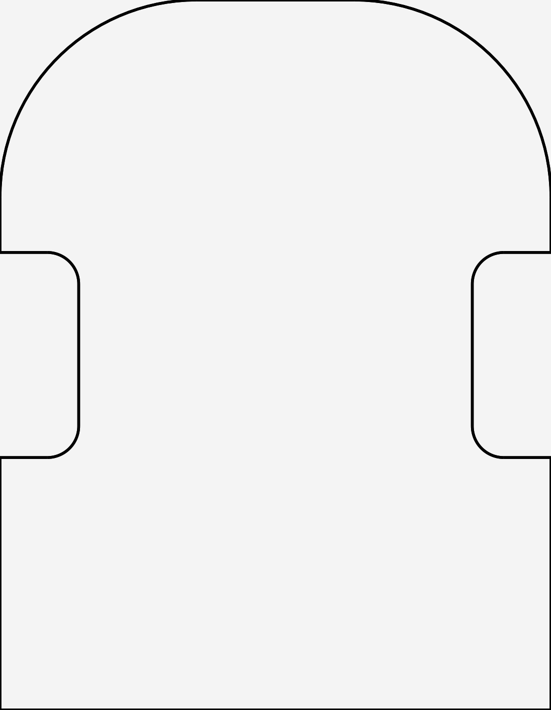

# 📐 Chasis V1 — placa base 70 × 90 mm

> 📅 **2026-10-05** · Estado: **contorno generado y verificado, SIN fabricar**.
> Nace de la necesidad de **rehacer el robot**: hoy va soldado sobre *protoboard* y cableado con
> *wrapping*, y eso hace imposible apantallar los sensores (ver
> [puesta-a-punto.md](./puesta-a-punto.md) §3). El rediseño en KiCad empieza por la **placa base**.

> **Nomenclatura**: esta pieza es la **V1** —el primer robot montado «de verdad», con la placa
> haciendo de chasis y la misma electrónica—. El prototipo que compitió (carcasa impresa y
> *protoboard*) es el hito **`OSHWDem26`** del repositorio. La **V2**, el salto de hardware
> (motores, microcontrolador), todavía no está decidida. Los ficheros se nombran por **versión
> del robot**, no por orden de creación.



---

## 1. Qué resuelve

| Problema del robot actual | Cómo lo resuelve esta placa |
|:--|:--|
| Chasis **106,7 × 84 mm** con esquinas delanteras vivas | **70 × 90 mm** con el frente redondeado: al girar en el sitio dentro de una celda de 180 mm las esquinas delanteras no barren más de la cuenta |
| Las ruedas van en el borde, sin sitio para el soporte | **Muescas laterales** de 26 × 10 mm **centradas**, que dejan el hueco para el conjunto rueda+motor |
| El *protoboard* fija la geometría y no se puede apantallar | La placa pasa a ser el soporte mecánico: los sensores se podrán separar y apantallar |

---

## 2. Cotas

| Cota | Valor | Nota |
|:--|--:|:--|
| Ancho (X) | **70,0 mm** | Es el lado del frente |
| Largo (Y) | **90,0 mm** | De la trasera al frente |
| Espesor | **3,0 mm** | |
| Radio de las esquinas delanteras | **25,0 mm** | Las dos del frente; el tramo recto central queda en 20 mm |
| Esquinas traseras | **rectas** | Añadir radio es cambiar una constante (ver §4) |
| Muesca de rueda: largo (Y) | **26,0 mm** | Centrada: de −13 a +13 mm |
| Muesca de rueda: profundidad (X) | **10,0 mm** | El fondo de la muesca queda a 25,0 mm del centro |
| Radio de acuerdo de las muescas | **4,0 mm** | **Interior**: el material *gana* en esas esquinas |
| Volumen | **16 576,4 mm³** | Área 5 525,5 mm² × 3 mm |

**Sistema de referencia**: origen en el **centro de la placa**, frente hacia **+Y**, espesor hacia
**+Z**. Así el centro de gravedad del montaje cae cerca del origen y las cotas de los agujeros que
vengan después se miden desde el centro, no desde una esquina.

---

## 3. Ficheros

| Fichero | Qué es | ¿Versionado? |
|:--|:--|:-:|
| `mechanical/freecad/chasis-v1.py` | **El diseño**: script parametrizado que genera la pieza | ❌ solo local |
| `mechanical/freecad/chasis-v1.step` | El **entregable** (sólido 3D) | ❌ derivado |
| `mechanical/freecad/verifica-chasis.py` | Comprueba cotas, forma y saca el DXF | ❌ solo local |
| `mechanical/freecad/chasis-v1.dxf` | Contorno 2D **para KiCad** (`Edge.Cuts`) | ❌ derivado |
| `mechanical/freecad/chasis-v1_planta.svg` | Croquis de planta | ❌ derivado |
| `images/chasis/chasis-v1-planta.png` | Croquis para esta documentación | ✅ |

⚠️ **De `mechanical/freecad/` solo se versionan los `.FCStd`.** Decisión del **2026-10-11**: al
repositorio sube el firmware y su documentación, y el **STEP es un entregable derivado** que se
regenera con el script, así que ni el script, ni el STEP, ni el verificador están en el repo: viven
solo en el disco del autor y hay que **regenerarlos con FreeCAD** (los comandos de §4). El croquis de
esta página sí se versiona, porque es documentación. Los ~784 MB de STEP de GrabCAD también quedan
fuera, como siempre.

---

## 4. Cómo se regenera (y cómo se cambia una cota)

Todo se hace **en consola**, sin abrir la interfaz. FreeCAD está instalado como *flatpak*:

```bash
# 1) Generar el STEP (imprime la comprobación de área y de volumen)
flatpak run --command=FreeCADCmd org.freecad.FreeCAD mechanical/freecad/chasis-v1.py

# 2) Verificar cotas y forma, y sacar el DXF para KiCad
flatpak run --command=FreeCADCmd org.freecad.FreeCAD mechanical/freecad/verifica-chasis.py

# 3) Croquis de planta en PNG (para esta documentación)
convert -density 400 mechanical/freecad/chasis-v1_planta.svg images/chasis/chasis-v1-planta.png
```

Las cotas están **todas juntas al principio** de `chasis-v1.py` (`ANCHO`, `LARGO`, `ESPESOR`,
`R_FRENTE`, `HUECO_LARGO`, `HUECO_PROF`, `HUECO_Y`, `R_HUECO`). Cambiar una y volver a ejecutar.

`verifica-chasis.py` está escrito **genérico en la estructura y específico en los datos**: el
nombre de la pieza, sus cotas y los puntos de la prueba de forma están juntos, al principio del
fichero, para reaprovecharlo con la V2 sin duplicarlo.

### Las dos comprobaciones que hace el script

1. **Área contra el cálculo teórico**, hecho de forma independiente en el propio script. Si un arco
   sale invertido o falta un tramo, **el área no cuadra** y el script avisa. Es lo que cazó los dos
   errores de construcción de la primera versión.
2. **Releer el STEP recién escrito** y comparar el volumen. Un STEP se puede escribir con la
   cabecera y **sin geometría**: pasó, y el fichero pesaba 1,6 KB en vez de 24,7 KB.

Y `verifica-chasis.py` añade una **prueba de forma** por puntos: le pregunta al sólido si diez
puntos concretos caen dentro o fuera (el frente recto, los dos arcos, las dos muescas, la trasera,
y dos puntos **fuera** de la pieza). El área y el *bounding box* por sí solos no distinguen **un
frente redondeado de uno trasero**.

---

## 5. Estado de las comprobaciones

| Comprobación | Resultado |
|:--|:--|
| Área del sólido frente a la teórica | ✅ **0,000 % de error** (5 525,5 mm²) |
| Relectura del STEP | ✅ mismo volumen (16 576,4 mm³) |
| Sólido válido | ✅ `isValid() = SI`, 20 caras · 54 aristas · 36 vértices |
| Cotas del *bounding box* | ✅ 70,000 × 90,000 × 3,000 mm |
| Centrado en el origen | ✅ centro en (0, 0, 1,5) |
| Prueba de forma (10 puntos) | ✅ **0 fallos** |

---

## 6. Lo que aún NO tiene

Es un **contorno**: el punto de partida, no el chasis terminado.

- **Agujeros de los motores** y de los soportes de rueda (necesitan la posición real del montaje).
- **Agujeros de los sensores** y de sus separadores de apantallamiento.
- **Alojamiento de la batería** y del *caster* trasero.
- **Radio en las esquinas traseras** (constante `R_TRASERA`, ya prevista en el script).
- **Ventanas** para el OLED y los pulsadores.
- **Alturas**: esta placa es plana; falta definir qué va encima y qué debajo, y ahí manda el
  **centro de gravedad** (importa para que no patine al acelerar, ver bloque 4 de
  [puesta-a-punto.md](./puesta-a-punto.md)).

---

## 7. Relacionado

- [puesta-a-punto.md](./puesta-a-punto.md) — la campaña de pruebas que motiva el rediseño
- [hardware.md](./hardware.md) — el robot **actual**: componentes, pinout y cotas de hoy
- [../mechanical/README.md](../mechanical/README.md) — el resto de la parte mecánica
