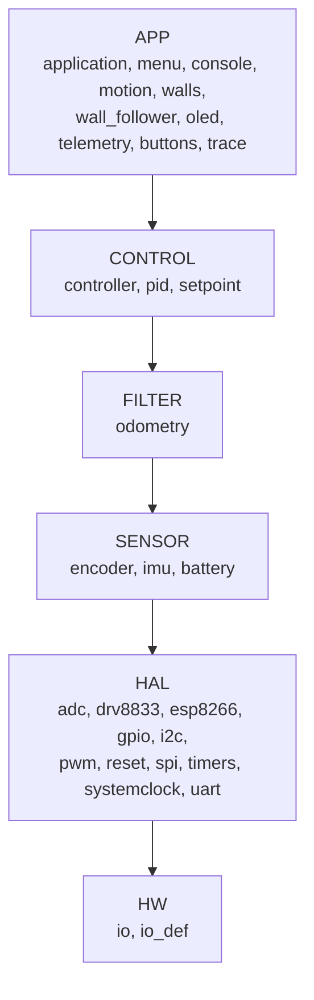
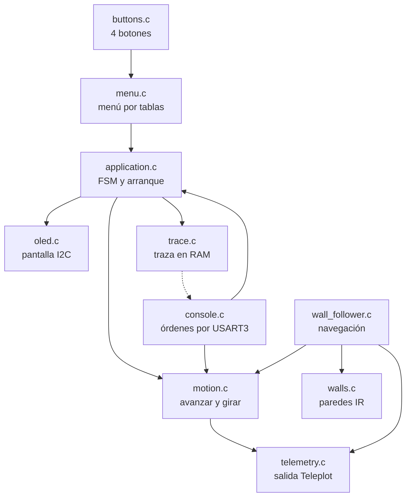
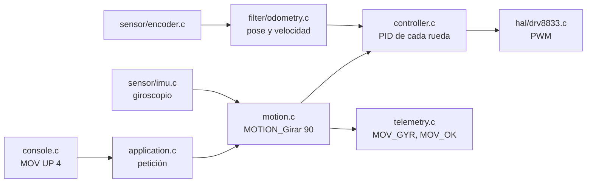
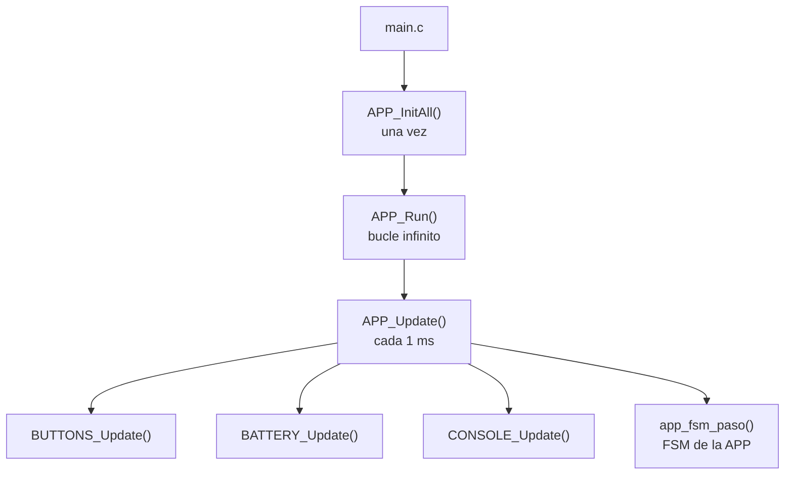
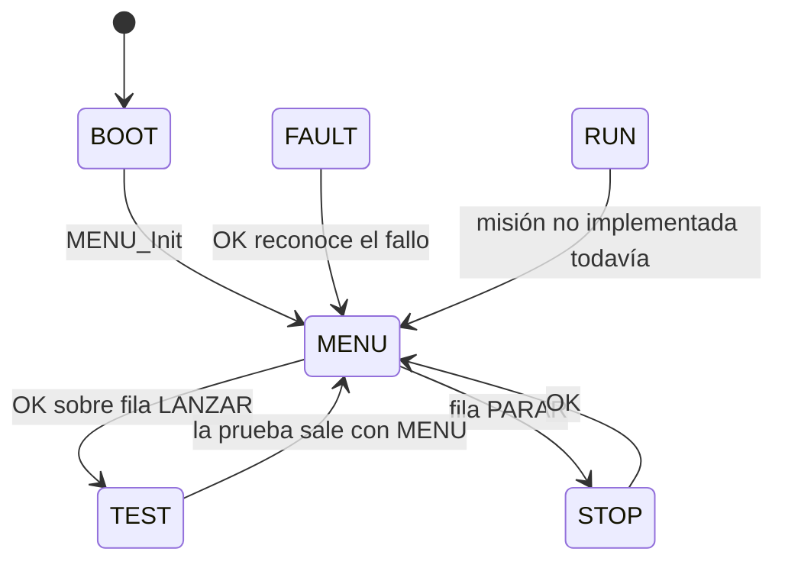
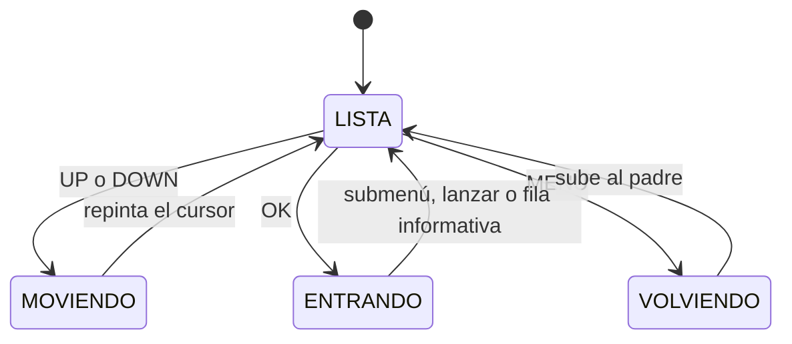

# 🗺️ Esquema del firmware — Rabosa-MVR

Mapa de lo que hay construido: las **capas**, lo que hace cada módulo de la **APP** y las **dos
máquinas de estados**. Responde a «¿dónde está esto y quién llama a quién?» sin abrir los `.c`.

> 📅 Estado a **2026-10-05** · RAM **33,3 %** (6 812 B) · Flash **80,7 %** (52 900 B) · **0 avisos**.
> Para el diseño de las FSMs y el árbol del menú, ver [maquina-estados-menu.md](./maquina-estados-menu.md).

---

## 1. Las capas

Una sola regla, sin excepciones: **cada capa solo llama a la inmediatamente inferior**. Nunca se salta
una capa ni se invierte la dependencia. Si un cambio toca dos capas, son **dos cambios**.



| Capa | Carpeta | Qué contiene | Qué **no** hace |
|:--|:--|:--|:--|
| **APP** | `app/` | Misión, menú, consola, primitivas de movimiento, navegación, telemetría y pantalla | No toca registros ni periféricos |
| **CONTROL** | `control/` | `controller.c` (un lazo de rueda), `pid.c` (PID + anti-windup), `setpoint.c` (rampa) | **No lee encoders ni escribe PWM**: entra mm/s, sale % de duty |
| **FILTER** | `filter/` | `odometry.c`: integra la pose (x, y, θ) desde los arcos de las ruedas | No decide nada |
| **SENSOR** | `sensor/` | `encoder.c` (TIM2/TIM3), `imu.c` (MPU-6500 por SPI2), `battery.c` | No filtra ni interpreta |
| **HAL** | `hal/` | Periféricos del MCU y **chips de fuera** (`drv8833.c`, `esp8266.c`, `reset.c`) | No conoce el robot |
| **HW** | `hw/` | `io.c` / `io_def.h`: pines y registros | — |

⚠️ **`hal/` mezcla periféricos del MCU con chips externos a propósito**: `drv8833`, `esp8266` y `reset`
son hardware gobernado por un periférico del MCU, y viven al mismo nivel que el `spi` o el `uart` que
los gobierna. No son «sensores» ni «actuadores» del robot en el sentido de la capa SENSOR.

---

## 2. La APP por dentro



| Módulo | Responsabilidad | API principal |
|:--|:--|:--|
| `application.c` | **Arranque + FSM de la APP** + las rutinas de banco + las tablas del menú | `APP_InitAll()`, `APP_Update()`, `APP_Run()`, `APP_FrenoTotal()` |
| `menu.c` | Menú por **tablas `const`**: scroll, pila de submenús, cursor, dibujo | `MENU_Init()`, `MENU_Update()`, `MENU_Dibujar()`, `MENU_IndiceActual()` |
| `console.c` | **Entrada**: monta líneas del anillo de USART3 y ejecuta órdenes (`BAT`, `PID`, `MOV`, `GYRO`, `LED`, `TRACE`, `HELP`) | `CONSOLE_Init()`, `CONSOLE_Update()` |
| `telemetry.c` | **Salida**: `>ETIQUETA:valor`. **Todo valor es numérico** | `TELEM_SendInt()`, `TELEM_SendFloat()` |
| `motion.c` | **Primitivas**: avanzar `mm` y girar `grados`, bloqueantes, con lazo cerrado sobre el giroscopio | `MOTION_Init/Avanzar/Girar/Parar`, `MOTION_SetGiroGanancia()` |
| `walls.c` | Tres paredes (`FRENTE = max(R0,R3)`, `DERECHA = R1`, `IZQUIERDA = R2`) con umbral por pared e histéresis. La medida es **encendido − apagado** | `WALLS_Actualizar()`, `WALLS_Hay()`, `WALLS_SetUmbral()` |
| `wall_follower.c` | Navegación por la mano: decide en el **centro de la celda** y ejecuta con `motion.c` | `WF_Paso()`, `WF_GetDecision()`, `WF_GetAtascado()` |
| `oled.c` | SSD1306 128×32 por I²C1, framebuffer propio y fuente 5×7 | `OLED_Print()`, `OLED_Update()` |
| `buttons.c` | 4 botones por sondeo; **MENU va por interrupción** y por eso responde siempre | `BUTTONS_GetEvent()`, `BUTTONS_SalidaSolicitada()` |
| `trace.c` | Anillo en **RAM**: 512 muestras × 4 canales, para depurar **sin cable** | `TRACE_Guarda()`, `TRACE_Descargar()` |
| `fsm.h` | Patrón de FSM del proyecto (*header-only*), sin código propio | `fsm`, `fsmstate()`, `fsmgoto()`, `fsmexit` |

⚠️ **Solo hay dos sitios que hablan por el puerto**: `telemetry.c` (salida) y `console.c` (entrada).
Ningún otro módulo escribe en la USART3 — y desde que el ESP8266 va en modo transparente, **ese puerto
es también el socket TCP**.

### El camino de un movimiento



Lo importante del dibujo: **el giroscopio entra en `motion.c`, no en CONTROL**. CONTROL no sabe que
existe una IMU; solo recibe una consigna en mm/s. El que cierra el lazo de ángulo es `motion.c`.

---

## 3. El bucle y el arranque



**Orden del arranque** (`APP_InitAll()`) y por qué importa:

1. `RESET_LeerCausa()` — **lo primero**, porque las banderas de reset se borran al leerlas.
2. `SystemClock_Config()`, GPIO, `BUTTONS_Init()`.
3. TIM1 (PWM), ADC1, **USART3 a 115200** + `CONSOLE_Init()`, y ya sale `>RESET` y `>BOOT:1`.
4. I²C1 + OLED (`>OLED`), PWM de los motores.
5. **Motores**: `motor1` va montado **en espejo** respecto a `motor2` ⇒ `motor1.invertido = 1`.
   Con los dos invertidos o ninguno, **uno de los dos lazos se realimenta al revés**.
6. `ENC_Init()` — es quien devuelve PA6/PA7 a entrada (MX_GPIO_Init los deja analógicos).
7. `BATTERY_Init()`, `WALLS_Init()` (emisores apagados y umbrales de arranque antes de que nadie
   pregunte por una pared), `TRACE_Init()`.
8. `IMU_Init()` **casi al final**, porque si el bus no responde se queda esperando.

Al terminar: **3 destellos del LED**. Es la señal de vida que no depende de la pantalla ni del PC: si
el robot se queda mudo y el LED no parpadea, el cuelgue es **durante** el init.

---

## 4. Máquina de estados de la APP

Vive en `app_fsm_paso()` (`application.c`) y publica cada transición con `>APP_EST`.



| Estado | `>APP_EST` | Qué hace | Cómo se sale |
|:--|:--:|:--|:--|
| `BOOT` | 0 | Inicializa el menú | Automático a `MENU` |
| `MENU` | 1 | Llama a `MENU_Update()` y actúa según la fila elegida | Botones |
| `TEST` | 2 | **Ejecuta la rutina de banco, que es bloqueante** | MENU (interrupción) |
| `STOP` | 3 | Motores frenados | OK |
| `FAULT` | 4 | Batería crítica: frena y avisa por pantalla y LED | OK |
| `RUN` | 5 | Misión | **Sin implementar** (vuelve a `MENU`) |

### Dos detalles que no se ven en el diagrama

**El despacho de `START`.** Como esta máquina **se reanuda de llamada en llamada**, `START` hace dos
cosas en cada paso: aplica las **guardas globales** y salta al estado en que se quedó. Ahí es donde va
todo lo que debe poder interrumpir a cualquier estado.

**La guarda de batería solo corta la misión.** El paso a `FAULT` exige `app_state == RUN`:

> en el banco se trabaja con fuente de laboratorio, y una batería baja **no puede** tapar la pantalla,
> parpadear el LED ni cortar una prueba. Para verla están la prueba `BATERIA` y `>VBAT_ESTADO`.

Y el `FAULT` **se reconoce con OK** aunque la medida siga crítica (`fault_reconocido`): si el aviso
sigue saltando, el robot quedaría encerrado sin poder ni entrar al menú. Cuando la medida se recupera
la marca se limpia, y así no hay bucle `FAULT → MENU → FAULT`.

---

## 5. Máquina de estados del menú

Vive en `menu_fsm_paso()` (`menu.c`) y publica `>MENU_EST`.



| Estado | `>MENU_EST` | Qué hace |
|:--|:--:|:--|
| `LISTA` | 0 | **Único estado que lee un botón**, y lo consume |
| `MOVIENDO` | 1 | Mueve el cursor y repinta |
| `ENTRANDO` | 2 | Entra en submenú, o **devuelve la entrada elegida** a la APP |
| `VOLVIENDO` | 3 | Sube un nivel; repinta solo si cambió de nivel |

⚠️ **El botón se consume en `LISTA`**, que es lo que evita repetir la transición en bucle al volver.
Y **sin botón no se publica ni se repinta**: un `OLED_Update()` son ~50 ms de bus I²C, y dibujar por
tiempo dejaba el bucle a ~20 Hz y **las pulsaciones cortas no se registraban** (ese fue el bug del
«los botones no hacen nada»).

---

## 6. El árbol del menú

Elegir una prueba es **una fila en una tabla**; el menú no sabe qué hay dentro de cada una.

```
RABOSA-MVR  (raíz)                      [9 filas · caben 3 · el voltaje del pack, arriba a la derecha]
├── BATERIA                             0 → TENSIONES · UMBRALES⛔ · CALIBRAR⛔
├── IR                                  1 → ENCENDER · LECTURA · UMBRALES · MODULADO · CURVA
├── MOTORES                             2 → SINTONIA · ENCODERS · MOVIMIENTO ·
│   │                                        CALIBRAR → (8) PPR A MANO · UM/CUENTA
├── TELEMETRIA                          3 → PUENTE WIFI · ESP8266 · TRAZA⛔ · CONSOLA⛔
├── EXPLORACION                         4 → MANO DERECHA · FLOOD FILL⛔
├── RESOLUCION                          5 → RESOLVER⛔
├── AJUSTES                             6 → VELOCIDAD⛔ · GUARDAR⛔ · INFO⛔
├── DIAGNOSTICO                         7 → BUS I2C · IMU · SENSORES · RESET⛔
└── PARAR                                   frena y va a STOP
```

⛔ = fila de tipo `MENU_TIPO_NINGUNA`: **se ve en la pantalla, pero el motor del menú no deja
elegirla**. Es la forma de dejar apuntado lo que falta sin que se pueda pulsar OK por error.

⚠️ **`submenus[]` es una lista plana y su índice es un contrato**: los números de la derecha son
posiciones en ese array. Quitar una tabla obliga a **renumerar**, y un índice mal puesto abre **la
tabla equivocada sin dar error de compilación**.

**Añadir una prueba** = una fila más en su tabla. **Quitarla** = **comentar la fila**: con
`--gc-sections`, una función que nadie referencia **se cae del binario** (así se recortaron 14 pruebas
y 9 212 B el 2026-10-02).

---

## 7. Las dos vías de entrada y salida

| | Entrada | Salida |
|:--|:--|:--|
| **Física** | 4 botones (`buttons.c`); MENU por **interrupción** | OLED (`oled.c`) + LED de la placa |
| **Puerto** | `console.c` — órdenes de texto | `telemetry.c` — `>ETIQUETA:valor` |

Las dos van por la **misma USART3** (PB10/PB11, 115200), que también es el socket TCP cuando el
ESP8266 está en modo transparente. Órdenes: `BAT`, `PID`, `MOV`, `GYRO`, `LED`, `TRACE`, `HELP`.
Ver [comandos-serie.md](./comandos-serie.md).

⚠️ **`CONSOLE_Update()` solo se llama en el menú y dentro de las pruebas 12, 18 y 20.** Las rutinas de
banco son bloqueantes: **si no llama a la consola en su bucle, las órdenes no se leen** hasta salir al
menú, que es justo cuando ya no sirven.

---

## 8. Dónde está hoy el fallo del laberinto

Para no volver a buscarlo: el robot **mide bien, decide bien y gira bien**. Lo que falla es el último
paso de `WF_Paso()`:

```c
wf_buscar_direccion();              /* mira, decide y orienta al robot */
MOTION_Avanzar(wf_m, WF_CELDA_MM);  /* ← 180 mm A CIEGAS */
```

**La pared se mide una sola vez, al principio del paso, y después se recorre la celda entera sin
volver a mirar.** Si el robot no queda bien centrado tras el giro, esos 180 mm acaban contra una pared
y el error se arrastra a la celda siguiente. Medido el 2026-10-02 en el laberinto: once celdas seguidas
viendo pared al frente y decidiendo media vuelta, con hasta 11 s empujando en un solo avance.

El resto de la cadena está descartado con medidas:

| pieza | estado |
|:--|:--|
| Giro de 90° | ✅ 361,9° en cuatro giros, dispersión 2,1° |
| Avance | ✅ 179/180/177 mm, rumbo a −0,9° |
| Sensor frontal | ✅ 0 en el aire y 179 con obstáculo; umbral 75 |
| Decisión | ✅ ve la pared y elige `WF_DEC` correcto |
| **Avance de la celda** | ❌ **va a ciegas** |
| Laterales | ❌ crosstalk; **el wall follower no los usa**, pero sin ellos no hay flood fill |

---

## 9. Relacionado

| Documento | Para qué |
|:--|:--|
| [maquina-estados-menu.md](./maquina-estados-menu.md) | Diseño de las FSMs y árbol del menú con detalle |
| [Layered Architecture.md](./Layered%20Architecture.md) | El origen de la regla de capas ⚠️ **aspiracional: cita STM32L4, MPU6050 por I²C y ficheros que no existen** |
| [comandos-serie.md](./comandos-serie.md) | Órdenes por el puerto |
| [pruebas-bringup.md](./pruebas-bringup.md) | Catálogo de pruebas de banco |
| [entorno-desarrollo.md](./entorno-desarrollo.md) | Toolchain, compilación y telemetría |
