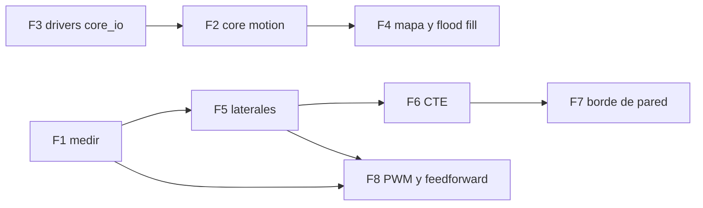

# 🧭 Estado del arte — Rabosa-MVR frente a los firmwares de referencia

> 📅 **2026-10-30** · Rama `develop` (`a726bbb`) · Build: **RAM 32,3 %** (6 608 B) ·
> **Flash 79,1 %** (51 816 B) · **0 avisos**.
>
> Documento **de decisión**, no de historia: qué tenemos, qué funciona (medido), qué está escrito pero
> no vale todavía, qué no tenemos y **en qué orden se ataca**. La evidencia está en
> [firmwares-referencia.md](./firmwares-referencia.md) (análisis de código), [plan-mejoras.md](./plan-mejoras.md)
> (qué falló) y [puesta-a-punto.md](./puesta-a-punto.md) (campaña con puertas). Aquí se juntan en una
> sola vista y se ponen al día con el código de hoy.

---

## 0. Leyenda

| Símbolo | Significado |
|:--:|:--|
| ✅ | **Funciona y está medido** en el robot, con la cifra y la fecha |
| ⚠️ | **Existe código** pero no se ha validado, o funciona a medias |
| ❌ | **No existe** |
| 🧱 | Bloqueado por otra cosa (normalmente, los sensores laterales) |

⚠️ **Aviso sobre la referencia.** El árbol `config.h · main.cpp · platform.cpp · encoders.cpp ·
motors.cpp · sensors.cpp · gyro.cpp · pid.cpp · motion.cpp · maze.cpp · solver.cpp` corresponde al
**`ukmarsbot-mazerunner` antiguo** (sketch de Arduino). El **`ukmars/mazerunner-core` actual es
*header-only*** (`mouse.h`, `maze.h`, `motion.h`, `profile.h`, `sensors.h`, `motors.h`, `encoders.h`,
`cli.h`, `reporting.h`, `systick.h`, `queue.h`, `battery.h`, más `config*.h`) y **no tiene** `pid.h`,
`gyro.h` ni `solver.cpp`: su control es por **posición**, y el *flood fill* vive **dentro de `maze.h`**.

---

## 1. Qué problema hay que resolver

Un micromouse tiene que **explorar un laberinto desconocido, volver a la meta y hacer la vuelta rápida**,
sin perder la posición. Todo lo demás (menú, telemetría, banco de pruebas) es andamiaje.

Eso deja **cuatro capacidades** que son las que deciden:

1. **Saber dónde está** (posición y rumbo) con una referencia que **no arrastre error**.
2. **Ir recto y girar exacto** entre celdas.
3. **Ver las paredes** (las tres que importan: frente, derecha, izquierda).
4. **Recordar el mapa** y decidir el siguiente movimiento.

Rabosa tiene (2) con matices, (3) solo el frente y (1) **solo con odometría y giroscopio**, que no son
referencia absoluta. (4) **no existe**.

---

## 2. Matriz de capacidades

| Capacidad | Rabosa-MVR | UKMARSBOT (`mazerunner-core`) | ZoroBot3 | KERISE |
|:--|:--|:--|:--|:--|
| **MCU / RAM** | F103C8T6 · 20 KB | ATmega328P · **2 KB** | F405RG · 192 KB | ESP32 · 520 KB |
| **Lenguaje / RTOS** | C puro · sin RTOS | C++ header-only · sin RTOS | C · sin RTOS | C++17 · **FreeRTOS** |
| **Líneas de firmware** | ~9 000 (con banco) | **5 735** | 8 382 | ~4 500 + librerías |
| **Lazo cerrado de rueda** | ✅ PID velocidad (0,5 % error) | **PD de posición + FF** | PID velocidad (6 lazos) | tracker de trayectoria |
| **Dirección (rumbo)** | ✅ giroscopio (89,51°) | por pared (CTE) + profiler | 3 lazos con laterales/frontales | encoders magnéticos 14 bit |
| **Sensores = distancia** | ❌ solo hay/no hay | ✅ normalizados a 100 | ✅ calibración `a,b,c` + offsets | ✅ VL6180X (ToF) |
| **Laterales utilizables** | ❌ **crosstalk** | ✅ (+CTE) | ✅ | ✅ |
| **Referencia absoluta** | ❌ ninguna | borde de pared al cruzar celda | **pérdida de pared lateral** | 壁切れ (opcional) |
| **Corrección lateral en el avance** | ❌ | ✅ CTE → error de giro | ✅ `KPI_SIDE_SENSORS` | ✅ |
| **Perfil de movimiento** | ⚠️ `core/profile.c` escrito y **no usado** | ✅ `profile.h` en uso | ✅ perfil de giro con `angular_accel` | ✅ perfil en S con *jerk* |
| **Mapa** | ❌ | ✅ 16×16, 1 byte/celda | ✅ | ✅ (`StepMap.h`) |
| **Flood fill** | ❌ | ✅ ~7 ms | ✅ por pesos | ✅ |
| **Persistencia de calibración** | ❌ (todo en RAM) | ✅ `.noinit` | ✅ EEPROM | ✅ SPIFFS |
| **Config por ejes** | ❌ defines sueltos | ✅ `HARDWARE`/`EVENT`/`ROBOT` | ✅ menús de config | ✅ `model.h` |
| **Calibración por rueda** | ❌ un µm/cuenta común | ✅ `MM_PER_COUNT_LEFT/RIGHT` | ✅ | ✅ |
| **Control en voltios** (compensa batería) | ❌ en % de duty | ✅ `MAX_MOTOR_VOLTS` | ✅ `voltage_to_motor_pwm` | — |
| **Banco de pruebas + telemetría** | ✅ **24 rutinas, 18 en menú** | ✅ `tests.cpp` por DIP | ✅ menú + `debug.c` | ✅ 16 modos |
| **Traza para depurar sin cable** | ✅ `TRACE` en RAM (4 canales) | ❌ | ❌ | ✅ logs |
| **Capas con contrato escrito** | ✅ `core/core_io.h` | ⚠️ de hecho, no garantizado | ❌ plano | ✅ OO |
| **Simulador en el PC** | ⚠️ solo módulos puros (`pid_sim`, `odometry_sim`, `profile_test`) | ❌ | ✅ MMSIM | ✅ pybind11 |
| **Licencia** | **GPL-3.0 (SW) · CERN-OHL-S (HW)** | **MIT** | **GPL-3.0** ⛔ | MIT |

⛔ **ZoroBot3 es GPL-3.0**: copiar su código obligaría a relicenciar todo el proyecto. Se puede **leer
sus ideas**, no su código.

---

## 3. Qué tenemos y funciona (medido)

| Pieza | Cifra medida | Cuándo |
|:--|:--|:--|
| Reloj, GPIO, UART3, ADC, PWM, I2C, SPI2, TIM2/TIM3 | Todas las pruebas de bring-up pasan | sep 2026 |
| **Encoder** con media móvil y `dt` **medido** | cuantía 14,3 mm/s = 287 µm / 20,02 ms | 11-oct |
| **µm/cuenta** | 287,0 (1 m empujado ⇒ −0,3 %) | 1-oct |
| **Trocha efectiva** | **77,6 mm** (giro de 90° a mano: +90°/−90°) | 1-oct |
| **PID de velocidad** por rueda | `Kp 0,10 · Ki 0,50 · Kd 0` ⇒ **0,5 %** de error, 0,6 s | 1-oct |
| **Planta del motor** (ruedas libres) | 71,5 mm/s por punto de duty · zona muerta ~10 % | 11-oct |
| **Giro de 90°** cerrado con giroscopio | 89,508° y 89,510° (±0,001°) | 11-oct |
| **Avance de celda** | 8 movimientos entre 177,7 y 181,1 mm | 1-oct |
| **Giroscopio**: sesgo y estabilidad | ±0,08° en 33 s · ±0,03° entre 4 giros | 11-oct |
| **Sensor frontal** de pared | **0** sin pared → **179** con ella (umbral 75) | 2-oct |
| **Batería** 2S con divisores 22k/10k | k calibrado 0,3015 · aviso/FAULT con salida por OK | 30-sep |
| **Banco de pruebas** | 24 rutinas catalogadas, 18 lanzables desde el menú | oct 2026 |
| **Consola + puente WiFi** | órdenes `TEST`/`SALIR`/`PID`/`MOV`/`GYRO`/`TRACE` | 11-oct |

**Lectura**: el **actuador y el lazo de velocidad están cerrados**. Lo que falta no es control de bajo
nivel, es **percepción y navegación**.

---

## 4. Qué tenemos escrito pero **no** vale todavía

| Qué | Estado real | Consecuencia |
|:--|:--|:--|
| `app/wall_follower.c` | Decide **bien** (`WF_DEC` correcto) pero `WF_Paso()` avanza **180 mm a ciegas** tras decidir | 11 s empujando contra la pared, `>WF_ATASCO:1` |
| Sensores **laterales** (R1 derecha, R2 izquierda) | Derecha = **2687 cuentas con el robot en el aire** (umbral 2050) ⇒ «hay pared» siempre. Izquierda a 158 del corte | El robot navega **de lado a ciegas**; sin laterales no hay CTE ni 壁切れ |
| `core/profile.c` (perfiles trapezoidales) | Escrito, probado en el PC con `test/profile_test.c`… y **0 llamadas** desde el firmware | No ocupa Flash (`--gc-sections` lo tira). `motion.c` usa su propia rampa |
| `core/core_io.h` (contrato de capas) | **0 implementaciones** (`CORE_IO_*` solo aparece en la cabecera) | La frontera existe en el papel, no en el binario |
| `drivers/` | **Carpeta con README, sin código** | `hal/drv8833.c` y las magnitudes de `sensor/` siguen mal colocadas |
| `app/motion.c` | Funciona, pero con **mínimos artificiales de velocidad** (35/50 mm/s) y sin perfil | Rebote en el giro; la fricción estática se combate a mano |
| Pruebas 14, 16, 17 y 23 | Escritas, **nunca ejecutadas** | `CURVA IR` (distancia en mm) no existe como dato |
| Prueba 19 (cuadrado 4×300 mm) | Recta y giro validados; el **cierre** no | No hay medida del error acumulado real |
| Prueba 22 (recorrido completo) | **Nunca completada** | El *wall follower* no ha terminado un laberinto jamás |

---

## 5. Qué no tenemos

| # | Qué | Quién lo tiene | Coste | Bloqueado por |
|:--:|:--|:--|:--|:--|
| 1 | **Mapa + flood fill** | los tres | 1 módulo nuevo (~400 líneas + 256 B de RAM) | — |
| 2 | **Laterales que vean** | los tres | Hardware: apantallar, bajar $R_L$ | — |
| 3 | **Referencia absoluta** (borde de pared) | ZoroBot3, KERISE (壁切れ), UKMARSBOT (al cruzar celda) | ~30 líneas | 🧱 2 |
| 4 | **Error lateral → error de giro (CTE)** | UKMARSBOT, ZoroBot3 | **~5 líneas** en `motion.c` | 🧱 2 |
| 5 | **Sensores en mm** (calibración no lineal) | ZoroBot3, KERISE | Calibración + tabla | 🧱 2 |
| 6 | **Control por posición + feedforward** | UKMARSBOT | Reescribir `motion.c` | — (decisión) |
| 7 | **Perfil de giro** con aceleración limitada | los tres | Reescribir `MOTION_Girar` | — |
| 8 | **PWM a 20 kHz** (100 → 3 600 pasos) | ZoroBot3 | 3 líneas en `hal/timers.c` | — |
| 9 | **Guardar calibración** (`.noinit`) | los tres | ~10 líneas + número mágico | — |
| 10 | **Ejes `HARDWARE`/`EVENT`/`ROBOT`** | UKMARSBOT | Reorganizar `pinout.h` | — |
| 11 | **Simulador** | ZoroBot3, KERISE | Mucho | — |
| 12 | Giros de 45° y diagonales | ZoroBot3, KERISE | Mucho | 🧱 1-4 |

📌 **Nótese el orden de magnitud**: la pieza que más falta (**mapa + flood fill**) es también la que
está **menos bloqueada** — no necesita hardware ni calibración nueva.

---

## 6. Dónde estamos en arquitectura

| | Rabosa-MVR | `mazerunner-core` |
|:--|:--|:--|
| Organización | **Capas con regla escrita**: `core → control → filter → sensor → hal → hw` | Módulos planos, todo en cabeceras, un `.ino` |
| Garantía | `core/` + `control/` + `filter/` = **1 408 líneas, 0 símbolos de la HAL**, compilan en el PC | *De hecho* portable, **sin interfaz que lo garantice** (lo dice su propia auditoría en `review/`) |
| Configuración | `pinout.h` + `peripherals.h` + defines | **3 ejes** (`HARDWARE`/`EVENT`/`ROBOT`) |
| Misión | FSM en `app/application.c`, estado `RUN` **sin implementar** | `mouse.h`: explorar, correr, calibrar |
| Control | PID de **velocidad** en `%` de duty | PD de **posición** con FF en **voltios** |

**La conclusión que importa**: nuestra arquitectura es *mejor* para crecer (y está auditada), pero el
**reparto de responsabilidades está a medias**: el contrato `core/core_io.h` se escribió **antes** que su
implementación, y hoy no hay ni una. Mientras no exista `drivers/core_io.c`, todo lo nuevo acaba en
`app/` y la capa portable no crece.

### Dónde va cada cosa a partir de ahora

| Módulo | Capa correcta | Hoy |
|:--|:--|:--|
| `maze.c` (mapa + flood fill) | **`core/`** | no existe |
| `motion.c` de la misión (perfiles + mezcla avance/giro) | **`core/`** | no existe (`app/motion.c` es banco) |
| `core_io.c` (implementa el contrato) | **`drivers/`** | no existe |
| `drv8833.c` | `drivers/` | `hal/` |
| `walls.c` (umbrales y emparejamiento) | `drivers/` o `sensor/` | `app/` |
| Menú, consola, telemetría, OLED, pruebas | `app/` | `app/` ✅ |

---

## 7. Los tres fallos que costaron la competición (medidos)

1. **`WF_Paso()` avanza a ciegas**: mide la pared una vez y recorre 180 mm sin volver a mirar. No es un
   fallo de sensor: el frente veía la pared (0 → 179) y la decisión era correcta.
2. **Los laterales están ciegos por *crosstalk***: la derecha da «pared» con el robot en el aire. Sin
   ellos no hay centrado en el pasillo, ni CTE, ni 壁切れ.
3. **No hay referencia absoluta**: odometría y giroscopio **acumulan y derivan**. Ocho celdas acaban «a
   tropezones» porque nada dice «estás exactamente aquí».

> La lectura de fondo: **el robot no se fía de sus ruedas para saber dónde está, pero nosotros sí.**
> Todos los demás sacan la referencia de **la pared**.

---

## 8. Pasos a dar, en orden

Cada fase tiene **una puerta medible**. No se pasa a la siguiente sin cerrarla. Las que se pueden hacer
**en paralelo** van marcadas.

### F1 — Medir antes de tocar (sin código) · en paralelo con F2
Cerrar las puertas **P1.1** (diferencia entre ruedas < 2 %), **P1.2** (rizo < 5 mm/s) y **P2.1/P2.3**
(los 4 canales distinguen pared a 90 mm con factor ≥ 3; en el aire, los 4 por debajo de su umbral).
Usa `SINTONIA` (18), `MOVIMIENTO` (20), `UMBRALES` (21), `LECTURA` (15) y `MODULADO` (16).
*Por qué primero*: si se cambia el actuador o el apantallado antes de medir, se pierde la referencia.

### F2 — `core/motion.c` con `PROF_*` · sin dependencias
Poner el perfil a trabajar: consigna recalculada **cada tick** en vez de «avanza 180 mm a ciegas».
Reutiliza `profile.c` (ya probado en el PC) y `core_io.h`.
**Puerta**: celda de 180 mm con error **< 3 mm** y **sin cambiar** lo ya medido (177,7–181,1 mm).

### F3 — `drivers/core_io.c` + mover `drv8833` a `drivers/` · en paralelo con F2
Cierra el contrato y la auditoría (`auditoria-capas.md` §6, hallazgos 3 y 4).
**Puerta**: `core/` sigue compilando con `gcc -c -Wall -Wextra` y con **0 símbolos `HAL_`**;
en el `.elf`, `CORE_IO_*` está enlazado y las pruebas 18/20 siguen dando lo mismo.

### F4 — `core/maze.c`: mapa + flood fill ✅ **la pieza que más falta**
Adaptar el esquema de `maze.h` de `mazerunner-core` (**MIT, citar**): 1 byte por celda, bit por pared,
paredes duplicadas entre vecinas, meta por configuración.
⚠️ **Con cola acotada y comprobación de desborde** — el propio autor de `mazerunner-core` señala que su
cola de 64 es *«unproven»* y desborda en silencio; un mapa corrupto sin aviso es peor que no tener mapa.
**Puerta**: banco en el **PC** (`firmware/test/maze_test.c`) con laberintos conocidos: distancias
correctas, meta alcanzable, sin desbordes; coste **≤ 300 B de RAM** y **≤ 3 KB de Flash**.

### F5 — Arreglar los laterales (hardware) · 🧱 desbloquea F6 y F7
Apantallar emisor↔receptor y barrido de $R_L$ (1,5 k · 2 k · 3 k · 4,7 k · 10 k) midiendo **relación
señal/crosstalk**, no señal máxima. Es la fase de **hardware** y la que más desbloquea.
**Puerta**: **P2.1/P2.2** — los 4 canales distinguen sin pared de pared a 90 mm con factor ≥ 3, y
repetible al ±5 %.

### F6 — CTE: el error lateral se suma al error de giro · 🧱 depende de F5
La idea más barata de todo el análisis: `cte = R−L`, convertido en **grados** y sumado al error de rumbo
que ya corrige `MOTION_GYRO_KP`. **No hace falta un lazo nuevo.**
**Puerta**: **P3.1** — 8 celdas seguidas con error acumulado **< 15 mm** y rumbo **< 3°**.
⚠️ Con **tope** en el ajuste: al barrer un borde de poste la lectura cae de golpe y el robot intentaría
«seguir el borde».

### F7 — Referencia absoluta por borde de pared · 🧱 depende de F5 y F6
Resetear una coordenada cuando la pared lateral desaparece (壁切れ). Es lo que impide que el error se
acumule celda a celda.
**Puerta**: **P3.2** — el error por celda deja de crecer monótonamente en 8 celdas.

### F8 — Actuador fino y *feedforward* · en paralelo con F5
PWM a 20 kHz (`PSC = 0`, `ARR = 3599`), quitar el `(int16_t)` de `DRV8833_Set_Speed` y añadir FF de
velocidad + aceleración + *bias* **con signo**, por rueda. Sustituye a los mínimos artificiales de 35/50 mm/s.
**Puerta**: **P1.1/P1.2** y **P4.2** (un solo cruce de banda por giro, sin rebote).

### F9 — Lo barato que quita fricción diaria · cuando se pueda
- **`.noinit`** para las calibraciones (número mágico + reinicio si no cuadra): ~10 líneas, y quita el
  «recalibrar después de cada flasheo».
- **Ejes `HARDWARE`/`EVENT`/`ROBOT`**: umbrales y geometría por recinto, en vez de la prueba 21 *in situ*.
- **µm/cuenta por rueda** (hoy hay uno común para las dos).
- **Arranque quitando la mano del sensor frontal** (los tres lo hacen; reutiliza un sensor que ya está).

### Lo que **no** se hace (y por qué)
| Descartado | Motivo |
|:--|:--|
| Control por posición con profiler completo | El FF de F8 ataca el mismo problema con una fracción del trabajo. Se replantea **con datos** |
| FreeRTOS | Super-bucle de 1 kHz + ISR; un contexto de RTOS en 20 KB no se paga |
| Perfiles en S con *jerk* limitado | A 250 mm/s no se nota; KERISE va a 720 |
| Giros de 45° y diagonales | Necesitan laterales + referencia absoluta + perfil de giro |
| Copiar código de **ZoroBot3** | **GPL-3.0** ⇒ relicenciaría el proyecto entero |

### Dependencias

Un camino crítico claro: **F5 (laterales) → F6 (CTE) → F7 (borde)**, y en paralelo
**F3 → F2 → F4 (mapa)**. El mapa no espera a nadie; los sensores laterales son los que esperan a la
soldadura y al apantallado.

---

## 9. Presupuesto de memoria

| Recurso | Ocupado | Libre | Qué cabe |
|:--|--:|--:|:--|
| **Flash** | 51 816 B (79,1 %) | **13 720 B** | `maze` (~3 KB) + `core/motion` (~2 KB) + consola/menú nuevos, con margen |
| **RAM** | 6 608 B (32,3 %) | **13 872 B** | mapa 16×16 (256 B) + cola BFS (~128 B) + traza + estado |

⚠️ **La Flash es el recurso escaso**, no la RAM. Regla vigente: si falta espacio **se recortan pruebas de
banco** (basta comentar la fila del menú, `--gc-sections` hace el resto), **no** se micro-optimiza el
código de las capas.

---

## 10. Resumen en cinco líneas

1. **Tenemos** un actuador bien medido, un lazo de velocidad cerrado, un giroscopio que gira a ±0,001° y
   un banco de pruebas por encima de la media.
2. **No funciona** nada que dependa de los laterales, y el *wall follower* avanza a ciegas.
3. **No tenemos** mapa, flood fill ni referencia absoluta: el robot no sabe dónde está más allá de sus
   ruedas.
4. **La arquitectura aguanta** (capas auditadas, 0 HAL en lo portable), pero `core_io.h` no tiene
   implementación y `drivers/` está vacía.
5. **El orden** es: medir (F1) · contrato y perfil (F2/F3) · **mapa (F4)** · laterales (F5) · CTE (F6) ·
   borde de pared (F7) · actuador fino (F8).

---

## 11. Relacionado

- [firmwares-referencia.md](./firmwares-referencia.md) — el análisis de código de los tres firmwares, fichero a fichero
- [plan-mejoras.md](./plan-mejoras.md) — qué falló medido y por qué se descarta lo que se descarta
- [puesta-a-punto.md](./puesta-a-punto.md) — procedimiento y tablas de resultados de los 4 bloques
- [auditoria-capas.md](./auditoria-capas.md) — la frontera `core/` ↔ `drivers/`, medida
- [estado-del-proyecto.md](./estado-del-proyecto.md) — snapshot de qué está hecho
- [esquema-firmware.md](./esquema-firmware.md) — cómo está montado el firmware hoy
