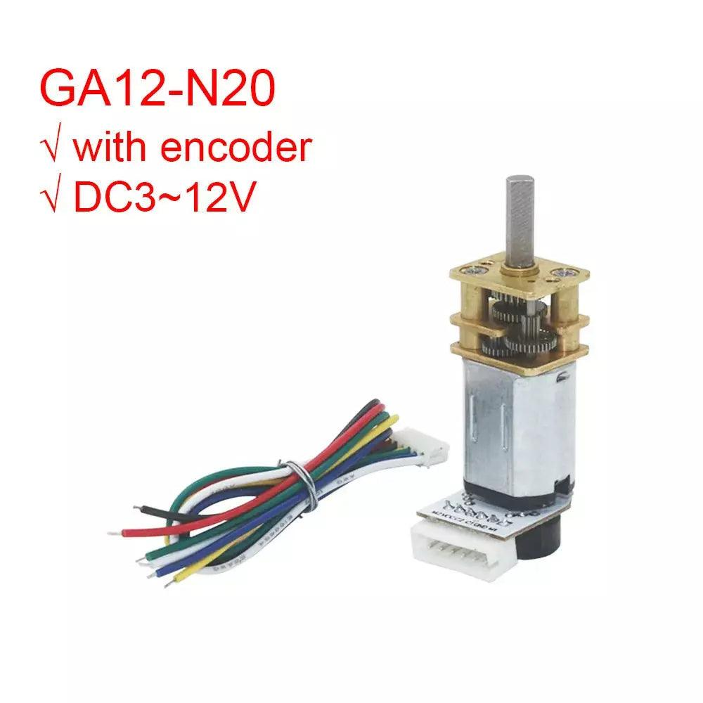
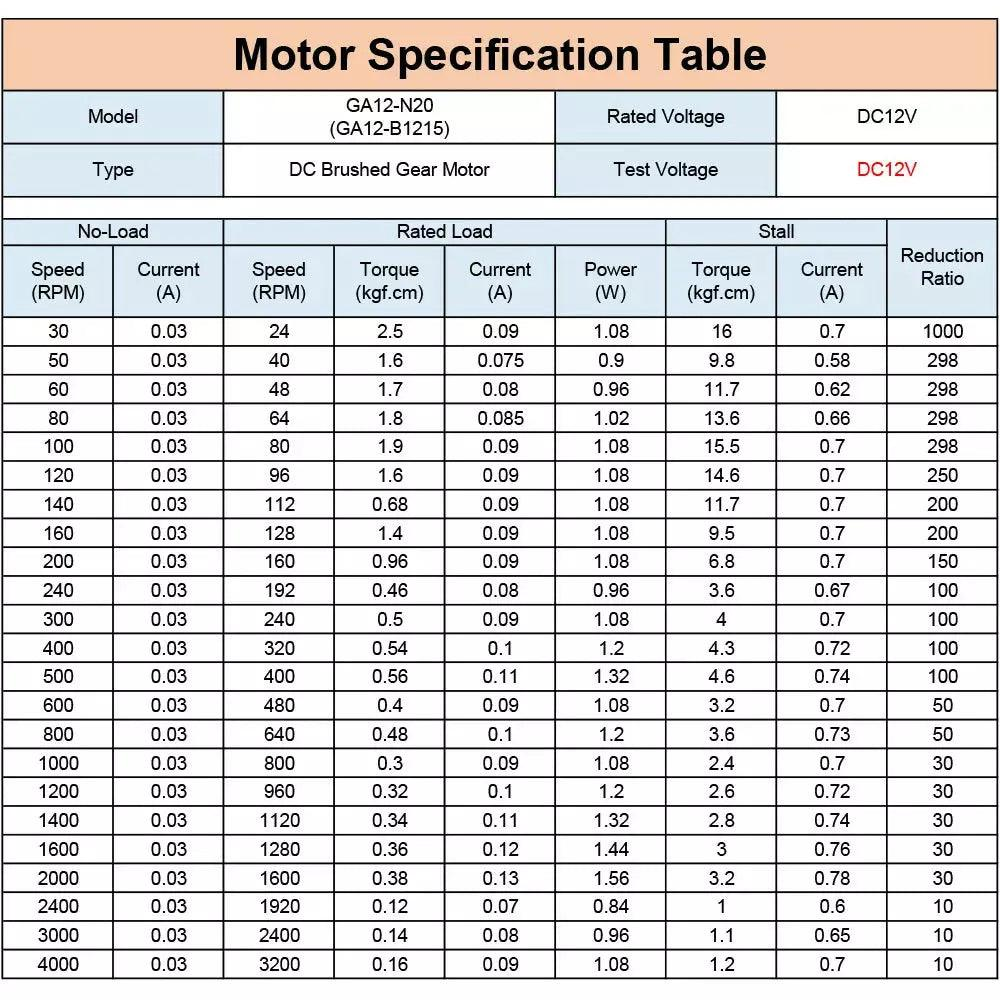
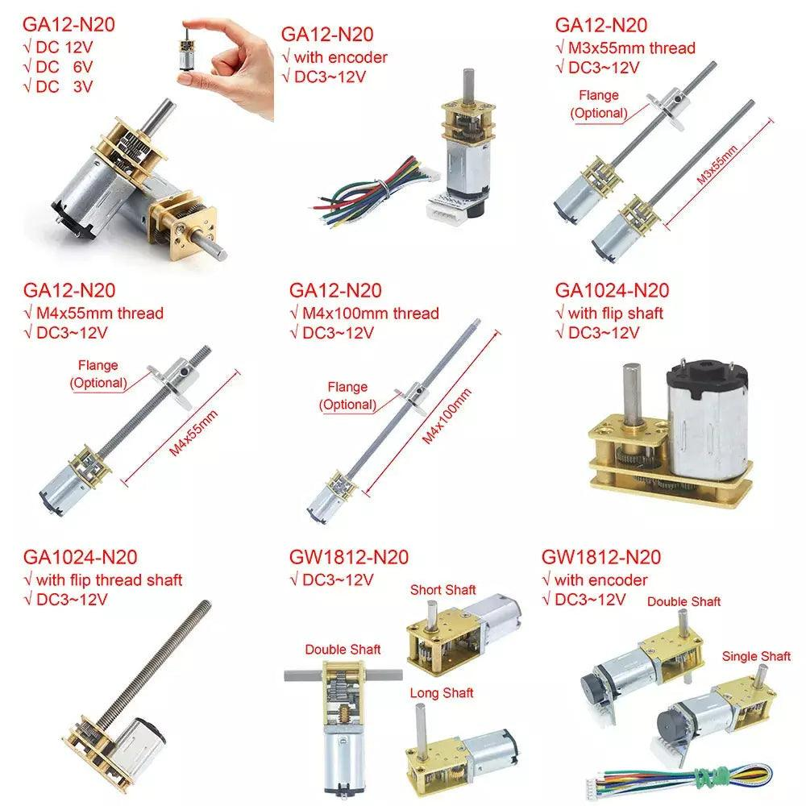
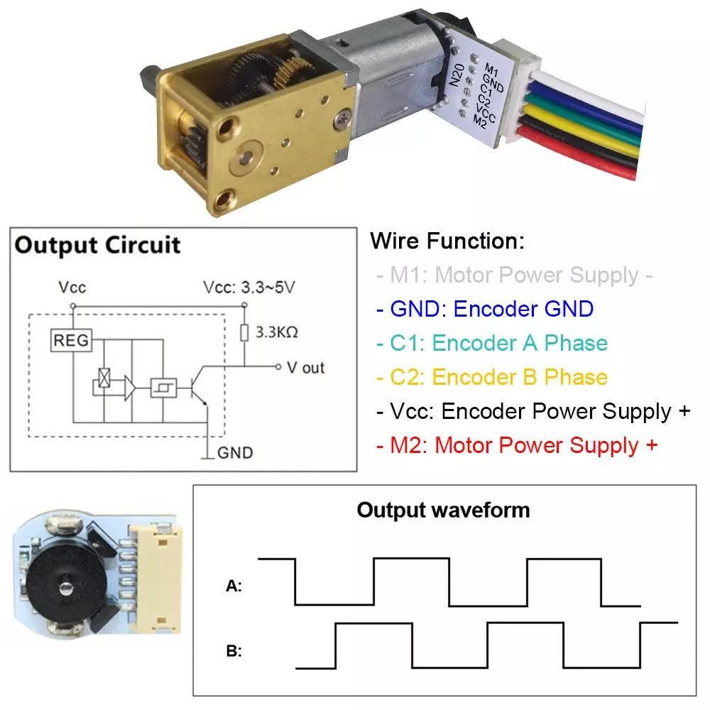
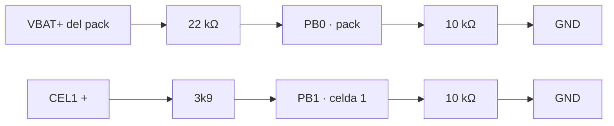

# 🔧 Hardware — Rabosa-MVR

Descripción completa del hardware del robot micromouse. Este documento es la **fuente de verdad**:
si el cableado y este documento no coinciden, hay un bug en uno de los dos.

---

## 1. Diagrama de bloques

```mermaid
graph TD
    classDef bateria fill:#2ecc71,stroke:#27ae60,stroke-width:2px,color:#fff;
    classDef potencia fill:#e74c3c,stroke:#c0392b,stroke-width:2px,color:#fff;
    classDef power fill:#304030,stroke:#2c3e50,stroke-width:2px,color:#fff;
    classDef logica fill:#3498db,stroke:#2980b9,stroke-width:2px,color:#fff;
    classDef sensores fill:#9b59b6,stroke:#8e44ad,stroke-width:2px,color:#fff;
    classDef debug fill:#d35400,stroke:#e67e22,stroke-width:2px,color:#fff;

    BAT[🔋 LiPo 2S 7.4V 450mAh 80C]:::bateria
    BOOST[⚡ MT3608 boost → 9V]:::potencia
    BUCK[📉 MP1584 buck → 5V]:::power
    DRV[🎛️ Driver DRV8833]:::potencia
    M1[⚙️ N20 GA12-N20 6V + encoder]:::potencia
    M2[⚙️ N20 GA12-N20 6V + encoder]:::potencia
    WH[🛞 Ruedas Ø21mm]:::potencia
    BP[🧠 Blue Pill STM32F103<br>regulador 3,3 V]:::logica
    LEDS[🚨 4 emisores SFH 4550<br>conmutados por 4 BC337]:::sensores
    IR_REC[👁️ 4 fototransistores ST-1KL3A]:::sensores
    IMU[🛰️ IMU MPU-9250/6500 (SPI2)]:::sensores
    ENC[🔢 Encoders N20]:::sensores
    BTNS[🔘 4 botones<br>MENU/UP/DOWN/OK]:::sensores
    OLED[🖵 OLED SSD1306 128×32]:::sensores
    USBTTL[🔌 Conversor TTL↔USB]:::debug
    BT[📶 BLE HJ-580XP (futuro)]:::debug

    BAT -->|7.4V| BOOST
    BAT -->|7.4V| BUCK
    BAT -->|ADC PB0/PB1| BP
    BOOST -->|9V| DRV
    DRV -->|Canal A| M1
    DRV -->|Canal B| M2
    M1 --- WH
    M2 --- WH
    BUCK -->|5V| BP
    BUCK -->|5V| OLED
    BUCK -->|5V| ENC
    BP -->|3.3V| IMU
    BP -->|3.3V| IR_REC
    BP -->|3.3V| LEDS
    BP -->|3.3V| BT
    BP -.->|PWM| DRV
    BP -.->|base 1 kΩ| LEDS
    IMU -.->|SPI2| BP
    ENC -.->|Timer encoder mode| BP
    IR_REC -.->|ADC1| BP
    BTNS -.->|GPIO pull-up| BP
    OLED <-.->|I2C1| BP
    USBTTL <-.->|USART3| BP
    BT <-.->|USART3| BP
```

> ⚠️ **El bloque de 5 V no es buck-boost**: el MP1584 es un reductor (*buck*), así que la
> salida de 5 V se degrada si la LiPo baja de ≈6 V. Los canales PB0/PB1 sirven para
> detectarlo.
>
> **Rieles confirmados (2026-09-21)**: el **3,3 V lo genera el regulador de la propia Blue Pill**
> y alimenta **IMU, emisores IR y receptores IR**; al riel de **5 V** cuelgan la **pantalla OLED**
> (con su propio regulador interno) **y los encoders de los N20**, que es como se han hecho las
> pruebas de motores y encoders. El módulo **AMS1117 externo no regula**: es el soporte físico del
> display.
>
> ✅ **Encoders a 5 V (medido)**: su salida es de colector abierto con pull-up interno, pero el
> módulo **no** entrega los 5 V: da **≈3,6 V de pico a pico**, dentro del máximo absoluto (4,0 V) de
> PA0/PA1/PA6/PA7. Se queda así; el análisis completo y la opción de ganar margen, en
> [§4.2](#42-encoders).

---

## 2. Resumen de componentes

| Bloque | Componente | Interfaz | Estado |
|:-------|:-----------|:---------|:------:|
| **MCU** | STM32F103C8T6 (Blue Pill) | — | ✅ |
| **Motores** | 2× **GA12-N20** (B1215) 6 V **1500 RPM**, con encoder y montura | PWM + TIM encoder | ✅ |
| **Reducción** | **1:10** caja GA12 (dato del fabricante) | — | ✅ |
| **Ruedas** | **Ø24 mm con goma** (llanta Ø20 + goma), **agujero en D** de Ø3,15 | — | ✅ rediseñadas 30-sep |
| **Chasis** | PLA, 106.7 × 84 mm | — | ⚠️ provisional |
| **Driver** | **DRV8833** (confirmado) | 4× PWM TIM1 | ✅ |
| **IMU** | Módulo MPU-9250/6500/9255 (IC marcado `MP65888LB1`) | SPI2 | ✅ |
| **Emisores IR** | 4× **SFH 4550** (860 nm, ±3°, $V_F$ 1.5 V @ 100 mA, 100 mA cont. / 1 A pulsado) | **Transistor BC337** (base por 1 kΩ) + **22 Ω** en serie | ✅ |
| **Receptores IR** | 4× **ST-1KL3A** (Kodenshi, 880 nm, ±6°, $I_L$ 5 mA @ 200 lx) | ADC1 + $R_L$ **3 kΩ** | ⚠️ a ajustar con las pruebas 1 y 15 |
| **Batería** | LiPo 2S 7.4 V **450 mAh 80C** | ADC PB0 + PB1 | ✅ |
| **Alimentación** | **MT3608** boost (9 V) + **MP1584** buck (5 V) + regulador **3,3 V de la Blue Pill** | — | ✅ |
| **Depuración** | **ST-Link v2 por SWD** (JTAG desactivado) + conversor TTL↔USB | SWD / USART3 | ✅ |
| **Botones** | 4 pulsadores **MENU · UP · DOWN · OK** | GPIO con pull-up interno | ✅ |
| **Pantalla** | **OLED SSD1306 128×32** por I2C | I2C1 (PB6/PB7) | ✅ |
| **LEDs** | Solo el integrado de la placa (PC13); el resto de pines se reasignó | GPIO | ⚠️ indicadores solo en PCB |

### 2.1 Núcleo

| Parámetro | Valor |
|---|---|
| MCU | STM32F103C8T6 (Blue Pill) |
| Núcleo | ARM Cortex-M3 |
| Reloj | 72 MHz (HSE 8 MHz + PLL ×9) |
| Flash / RAM | 128 kB / 20 kB |
| Framework | STM32Cube HAL |
| Carga | ST-Link v2 por **SWD** en `/dev/stlinkv2_2` |

---

## 3. Pinout oficial (V1)

> **Fuente**: [`Pinout.pdf`](./Pinout.pdf) / `Pinout.ods` (LibreOffice Calc, 3 sep 2026).
> El PDF se puede volcar a texto con `pdftotext -layout Documentacion/Pinout.pdf -`.
> Si cambias el pinout en el ODS, regenera el PDF y actualiza esta tabla.

| Pin | Puerto | Función HW | Uso | Etiqueta | Telemetría |
|:---:|:------:|:-----------|:----|:---------|:----------:|
| 10 | PA0 | TIM2_CH1 | Encoder 1A | M1ENCA | E1 |
| 11 | PA1 | TIM2_CH2 | Encoder 1B | M1ENCB | E2 |
| 12 | PA2 | ADC1_IN2 | Sensor de pared | WALL A1 | A1 |
| 13 | PA3 | ADC1_IN3 | Sensor de pared | WALL A2 | A2 |
| 14 | PA4 | ADC1_IN4 | Sensor de pared | WALL A3 | A3 |
| 15 | PA5 | ADC1_IN5 | Sensor de pared | WALL A4 | A4 |
| 16 | PA6 | TIM3_CH1 | Encoder 2A | M2ENCA | E3 |
| 17 | PA7 | TIM3_CH2 | Encoder 2B | M2ENCB | E4 |
| 29 | PA8 | TIM1_CH1 | PWM Motor 1A | PWM1A | M8 |
| 30 | PA9 | TIM1_CH2 | PWM Motor 1B | PWM1B | M9 |
| 31 | PA10 | TIM1_CH3 | PWM Motor 2A | PWM2A | MA |
| 32 | PA11 | TIM1_CH4 | PWM Motor 2B | PWM2B | MB |
| 33 | PA12 | GPIO | **Botón OK** (entrada, pull-up) | `BTN_OK` | — |
| 34 | PA13 | SWDIO | Programación y debug — **no reconfigurar** | SWDIO | — |
| 37 | PA14 | SWCLK | Programación y debug — **no reconfigurar** | SWCLK | — |
| 38 | PA15 | GPIO | Libre (era JTDI; JTAG desactivado) | — | — |
| 18 | PB0 | ADC1_IN8 | Batería: **total** (VCC−GND) | ADC_BAT 1 | B1 |
| 19 | PB1 | ADC1_IN9 | Batería: **celda 1** | ADC_BAT 2 | B2 |
| 20 | PB2 | BOOT1 | Programación y debug | BOOT1 | — |
| 39 | PB3 | GPIO | Emisor IR 1 (salida, JTAG desactivado) | WALL L1 | — |
| 40 | PB4 | GPIO | Emisor IR 2 (salida, JTAG desactivado) | WALL L2 | — |
| 41 | PB5 | GPIO | Emisor IR 3 (salida) | WALL L3 | — |
| 42 | PB6 | I2C1_SCL | **OLED** (y lo que venga) · SCL | SCL | — |
| 43 | PB7 | I2C1_SDA | **OLED** (y lo que venga) · SDA | SDA | — |
| 45 | PB8 | GPIO | Emisor IR 4 (salida) | WALL L4 | — |
| 46 | PB9 | GPIO | **Botón UP** (entrada, pull-up) | `BTN_UP` | — |
| 21 | PB10 | USART3_TX | Telemetría / programación | TX | — |
| 22 | PB11 | USART3_RX | Telemetría / programación | RX | — |
| 25 | PB12 | SPI2_CS | SPI (IMU) | CS | — |
| 26 | PB13 | SPI2_SCK | SPI (IMU) | SCK | — |
| 27 | PB14 | SPI2_MISO | SPI (IMU) | MISO | — |
| 28 | PB15 | SPI2_MOSI | SPI (IMU) | MOSI | — |
| 2 | PC13 | GPIO | **LED onboard** (salida) | — | — |
| 3 | PC14 | GPIO | **Botón MENU** (entrada, pull-up, `OSC32_IN`) | `BTN_MENU` | — |
| 4 | PC15 | GPIO | **Botón DOWN** (entrada, pull-up, `OSC32_OUT`) | `BTN_DOWN` | — |

**Ventajas de este reparto**: 4 canales analógicos para paredes (WALL A1–A4) y 2 para el
estado de la batería (PB0 total, PB1 celda 1); 4 emisores IR independientes (WALL L1–L4);
**4 botones de usuario** con pull-up interno; y UART, SPI, I2C y SWD en buses de hardware
dedicados que no se pisan.

> [!NOTE] Cambios respecto al pinout del PDF
> Frente a [`Pinout.pdf`](./Pinout.pdf): PB1 deja de ser sensor de pared y pasa a ser
> **batería, celda 1**; los emisores IR bajan de 5 a **4** (`WALL L1`–`L4`); y los pines que el
> PDF etiquetaba como «LED 1…6» (PA12, PA15, PB9, PC13, PC14, PC15) han acabado siendo
> **4 botones** más el LED integrado (ver la sección 4.8).

### Asignación analógica en el HAL

`hal/adc.h` (`ADC_Pin_t`): `A2`→canal 2 · `A3`→3 · `A4`→4 · `A5`→5 · `B0`→8 · `B1`→9.

---

## 4. Bloques de hardware

### 4.1 Motores, transmisión y chasis

#### Motores

| Parámetro | Valor |
|---|---|
| Familia / modelo | **GA12-N20 (motor B1215)** con encoder — nuestro ejemplar es la variante **6 V 1500 RPM** |
| Modelo del fabricante | `GA12-N20-S0310D-E` (marca *Anmiy*) |
| Tipo | Motor DC **con escobillas** + caja de engranajes **GA12** de engranajes rectos |
| Tensión nominal | **12 V** de catálogo, **rebajable a 6 V o 3 V** (velocidad, par y corriente escalan proporcionalmente) |
| Velocidad | **1500 RPM** a la salida con 6 V (3000 RPM a 12 V) |
| **Reducción** | **1:10** ✅ confirmada por el fabricante (ver la nota de abajo) |
| Potencia / peso | 1 W · ≈11 g · cuerpo Ø12 × 30,5 mm (36 mm con la caja) |
| Eje | Ø3 × 10 mm, con **D-cut** de 2,5 × 9,5 mm |
| Encoder | Magnético (Hall) de **2 canales** en cuadratura, **7 PPR**, 100 kHz → [§4.2](#42-encoders) |
| Montura | Con soporte (*with mount*) |
| Enlace | `es.aliexpress.com/item/1005006213216702.html` |



**Curva de la variante de reducción 1:10** (tabla del fabricante, medida a 12 V):

| Régimen | Velocidad | Par | Corriente |
|:--------|:----------|:----|:----------|
| Sin carga | **3000 RPM** a 12 V ⇒ **1500 RPM a 6 V** ✓ *la nuestra* | — | 0,03 A |
| Carga nominal | 2400 RPM a 12 V | 0,14 kgf·cm (≈14 mN·m) | 0,08 A |
| **Bloqueado** | 0 | **1,1 kgf·cm** (≈108 mN·m) a 12 V ⇒ ≈**54 mN·m** a 6 V | 0,65 A |



> [!NOTE] La reducción **1:10** ya no es una hipótesis
> El fabricante publica **una tabla común** para toda la familia: cada fila de velocidad de salida
> lleva su **relación de reducción** en la última columna. La fila de **3000 RPM a 12 V** (1500 RPM
> a 6 V, la nuestra) es la de **ratio 10**.
> Además las variantes encajan entre sí: **6 V 1500 RPM ⇄ 3 V 750 RPM ⇄ 12 V 3000 RPM**.
> Se mantiene la medición de la prueba 7 como **verificación** (nunca está de más).

**Estimación por correlación de variantes** (el razonamiento que se usó antes de tener la tabla):

| Velocidad a 6 V | 1500 | 750 | 500 | 300 | 150 | 50 |
|:---|---:|---:|---:|---:|---:|---:|
| Reducción implícita | **1:10** | 1:20 | 1:30 | 1:50 | 1:100 | 1:300 |

> La tabla de arriba cuadra con la del fabricante: sirve como comprobación cruzada, no como fuente.



**Cómo medir la reducción y el PPR** (sin abrir el motor):

1. Marca una referencia en la rueda y en el chasis.
2. Gira la rueda a mano **exactamente 10 vueltas**.
3. Lee el total de pulsos del encoder (decodificación ×4).

$$
\text{PPR} = \frac{\text{pulsos}}{4 \times 10 \times n} \qquad
n = \frac{\text{pulsos}}{4 \times 10 \times \text{PPR}}
$$

Si se desconoce el otro parámetro, se obtiene el **producto** $n \cdot \text{PPR}$. Para
separarlos: contar también las vueltas del eje del motor (o mirar la relación de engranajes).

#### Driver

| Elemento | Detalle |
|---|---|
| Driver | **DRV8833** (2 canales H-bridge) — confirmado por el autor |
| Control | 4 PWM de TIM1 (`PWM1A/B`, `PWM2A/B`) + `DRV8833_Set_Speed()` |
| Alimentación | 9 V desde el MT3608 (pin VM del driver) |

**Reparto de canales del DRV8833** (según `include/pinout.h` y `hal/timers.c`; `MX_TIM1_Init()`
configura PA8–PA11 como salida alterna, así que `gpio.c` no toca estos pines):

| Canal del driver | Entradas | PWM del MCU | Estructura del firmware | Rueda |
|:-----------------|:---------|:------------|:------------------------|:------|
| A | `AIN1` / `AIN2` | **PA8** (TIM1_CH1) / **PA9** (TIM1_CH2) | `motor1` | **izquierda** |
| B | `BIN1` / `BIN2` | PA10 (TIM1_CH3) / PA11 (TIM1_CH4) | `motor2` | **derecha** |

> ✅ **Izquierda/derecha identificados en banco el 2026-09-19**: canal A = izquierda, canal B =
> derecha (se movió cada par de pines por separado con la prueba de banco 9, `App_Test_PWM_Rampa()`,
> seleccionable con `PWM_RAMPA_MOTOR`). El mismo reparto se aplica a los **encoders** (ver 4.2):
> PA0/PA1 (TIM2) es el de la izquierda y PA6/PA7 (TIM3) el de la derecha.

> ⚠️ **Sentido de giro: el motor 1 va montado al revés que el 2** (comprobado el 30-sep: con el mismo
> signo de duty, M1 giraba en sentido contrario). Se arregla en el firmware **cruzando sus dos canales**
> (`motor1.channel1 = TIM_CHANNEL_2` y `channel2 = TIM_CHANNEL_1`, en `APP_InitAll()`), así que un duty
> positivo mueve las dos ruedas **hacia adelante** y no hay que invertir el signo en cada prueba. El
> freno y el coast no se ven afectados, porque usan los dos canales a la vez.

#### Chasis y ruedas

| Parámetro | Valor |
|---|---|
| Material | **PLA** (impresión 3D) |
| Medidas | 106.7 × 84 mm |
| Trocha (reportada) | **82.8 mm** |
| Distancia entre ejes de motor | **83.6 mm** |
| **Trocha efectiva $L$ (medida)** | **77.6 mm** ✅ (2026-10-01, prueba 19) |
| Rueda **montada** (nueva, 30-sep) | **Ø24 mm con la goma puesta**, medido con el calibre |
| Llanta impresa | **Ø20 mm** (radio 10), agujero **en D** de Ø3,15 y cubo de 5 mm |
| Goma | **Ø20 interior / Ø24 exterior** |
| Ancho de rueda | 8 mm |

> [!IMPORTANT] Con las ruedas nuevas el **µm/cuenta medido es 287,0**, y el nominal de Ø24 da 269,3
> Medido empujando el robot 1 000 mm, en la única pasada recta de las cinco (|P1−P2| = 3 cuentas); las
> otras cuatro salieron 289–291, más altas porque el robot giró y la media de las dos ruedas dejó de ser
> el avance del centro.
>
> | Magnitud | Valor | Cómo sale |
> |:--|:--|:--|
> | Circunferencia **nominal** (Ø24) | **75,4 mm** | π × 24 |
> | Cuentas por vuelta de rueda | **270,7** | Medidas girando la rueda a mano |
> | **µm por cuenta medido** | **287,0** | Empujando 1 m con las ruedas nuevas |
> | µm por cuenta nominal | 269,3 | 75 398 / 280 |
> | **Ø efectivo derivado** | **24,7 mm** | 287,0 µm/cuenta × 270,7 cuentas/vuelta |
>
> ⇒ El medido supera al nominal un **6,6 %**, y el Ø efectivo que implica (24,7) es **mayor** que los 24
> medidos con el calibre. La explicación más probable es que **el calibre comprime la goma blanda** al
> medirla, así que el diámetro real en reposo será ≈25,4 mm. La cifra que manda es la **medida**.
>
> ⚠️ Y ojo con la consecuencia: el robot va un **6 % más rápido** a igual duty que con el factor antiguo
> (270,7), y la odometría contaba un 6 % de menos hasta ahora.
>
> ✅ El **agujero ya es en D** (rediseño del 30-sep): es lo que impide que la rueda gire y se incline
> respecto al eje, que era la causa de la oscilación de velocidad una vez por vuelta y de que el robot
> se torciera.

> [!NOTE] La trocha efectiva ya está medida: **77,6 mm** (2026-10-01)
> La odometría no necesita la trocha geométrica, sino la **efectiva** $L$: la distancia entre los
> **centros de contacto** de las dos ruedas, que incluye el deslizamiento. No se mide con el calibre:
> se **deduce** del robot girando.
>
> Con los **83,6 mm** entre ejes de motor (el valor provisional) un giro de 90° a mano se estimaba en
> **83°** —un 7 % corto— y con el **mismo sesgo en los dos sentidos** ⇒ el fallo era de $L$, no de los
> encoders. De ahí el valor definitivo:
>
> $$L = 83{,}6 \times \frac{83{,}5}{90} = 77{,}6\ \text{mm}$$
>
> Sale **menor** que la geométrica, que es lo esperable en un robot que arrastra las ruedas al pivotar.
> Los 82,8 mm «reportados» y los ≈74,8 mm que salían de «41,4 mm desde el exterior de la rueda» eran
> estimaciones; la cifra que manda es la **medida**.
> Procedimiento en [pruebas-bringup.md](./pruebas-bringup.md) §15.

Las ruedas se van a rediseñar para acercarlas al centro; los ejes de los motores seguirán
asomando por fuera de las ruedas. Cuando cambien, **actualiza esta misma sección** y los
valores de $r$ y $L$ en [cinemáticas.md](./cinemáticas.md) y [odometria.md](./odometria.md):
la trocha entra directamente en la cinemática.

**Criterios para el rediseño** (30-sep: las ruedas actuales **entran torcidas en el eje** y eso
contamina todas las medidas):

| Criterio | Por qué |
|:---------|:--------|
| **Agujero en D**, no redondo | El eje del N20 es Ø3 mm con un *D-cut* de 2,5 × 9,5 mm. Un agujero redondo con holgura deja que la rueda gire y se incline respecto al eje |
| **Cubo más largo** | Reparte el agarre sobre más eje y evita la inclinación; es lo que pidió el usuario |
| **Tolerancia del agujero**: Ø**3,15–3,25** mm y **2,65–2,75** en el rebaje | En FDM los agujeros salen 0,1–0,3 mm **más pequeños**: un agujero dibujado a Ø3,0 no entra, y forzarlo **tuercía la rueda**. Tabla completa y trucos en [mechanical/README.md §3b](../mechanical/README.md) |
| **Prisionero M2 radial** contra la cara plana | Libera al agujero de sujetar: la rueda no gira respecto al eje aunque haya holgura, y se puede desmontar |
| **Concentricidad** | El agujero centrado respecto al exterior: si no, la rueda *cojea* una vez por vuelta (velocidad y odometría oscilantes) |
| **Perpendicularidad** | La cara del cubo a 90° con el eje del agujero, o la rueda rueda sobre el borde |
| Mantener la goma si se quiere conservar el factor | Si cambia el Ø efectivo hay que **volver a medir** los µm/cuenta |

> 💡 Una rueda descentrada o torcida **no cambia los pulsos** (el encoder va en el eje del motor), así que
> no se ve en las pruebas de encoder: se ve como **oscilación de velocidad una vez por vuelta** y como
> **µm/cuenta inflado**. Fue la pista del 30-sep para sospechar de las ruedas.

### 4.2 Encoders

- **Modo hardware (TI12, ×4 resolución)** en TIM2 (PA0/PA1) y TIM3 (PA6/PA7).
- El contador es de 16 bits → hay que resolver el *overflow* y la dirección.
  Para eso se usa `max_likelihood_counter_diff()`, que compara la diferencia directa e
  inversa y toma la menor como dirección real.
- Salidas disponibles: pulsos diferenciales con signo, total acumulado, distancia (µm) y
  velocidad (m/s).
- Detalle de uso: [`../firmware/sensor/encoders.md`](../firmware/sensor/encoders.md).

**Cableado (indicado por el usuario y ya contrastado con el pinout, 2026-09-19)**:

| Rueda | Señal | Pin | Timer | Etiqueta del pinout |
|:------|:------|:---:|:------|:--------------------|
| **izquierda** | A | **PA0** | TIM2_CH1 | `M1ENCA` |
| **izquierda** | B | **PA1** | TIM2_CH2 | `M1ENCB` |
| **derecha** | A | **PA6** | TIM3_CH1 | `M2ENCA` |
| **derecha** | B | **PA7** | TIM3_CH2 | `M2ENCB` |

> ✅ Coincide exactamente con lo que ya esperaba el firmware (`sensor/encoder.c`),
> **no hizo falta cambiar la configuración**: el modo encoder ya estaba programado con
> `TIM_ENCODERMODE_TI12`, entradas con pull-up y contador de 16 bits.

**Especificaciones del encoder (fabricante, 2026-09-21)**

| Parámetro | Valor |
|---|---|
| Tipo | **Magnético (Hall)** con disco ranurado montado en el **eje del motor** (antes de la reductora) |
| Señal | **Cuadratura AB**, dos ondas cuadradas desfasadas 90° |
| Tensión de alimentación | **DC 3,3 – 5 V** |
| **PPR** | **7 pulsos por vuelta del eje del motor**, por canal |
| Frecuencia de respuesta | **100 kHz** |
| Salida | **Colector abierto** con **pull-up de 3,3 kΩ** en el módulo ⇒ *el nivel alto acompaña al riel del pull-up* |
| Cables | 6 hilos (≈150 mm) |



**Patillaje y colores de cable** (los de la imagen del fabricante):

| Pin | Color | Función |
|:--|:--|:--|
| `M1` | gris | Motor: **−** (intercambiar M1/M2 invierte el sentido) |
| `M2` | rojo | Motor: **+** |
| `GND` | azul | Masa del encoder |
| **`VCC`** | blanco | Alimentación del encoder: **3,3 – 5 V** ⚠️ *no invertir VCC y GND* |
| `C1` | verde | **Fase A** |
| `C2` | amarillo | **Fase B** |

**Resolución y factor de distancia** (lo que se programa en `sensor/encoder.h`):

| Magnitud | Valor | Cuenta |
|:---------|:------|:-------|
| Pulsos por canal y vuelta de motor | **7** | PPR |
| Pulsos por canal y vuelta de **rueda** | **70** nominal · **~67,7** medidos | 7 × 10 (reducción) |
| **Cuentas por vuelta de rueda** (modo ×4, TI12) | **280** nominal · **270,7** medidas | 4 × 7 × 10 · medida del 30-sep |
| Circunferencia nominal de la rueda | **75,4 mm** | π × 24 (**Ø24 con goma**, medido) |
| Circunferencia efectiva (rodadura) | **77,7 mm** | Derivada: 287,0 µm/cuenta × 270,7 cuentas/vuelta |
| **µm por cuenta** | **287,0 µm** medida · 269,3 nominal | 77 700 / 270,7 |

⇒ 10 vueltas de rueda = **2707 cuentas** = **777 mm**. El nominal diría 754 mm.

> ⚠️ **La circunferencia efectiva (77,7) sale mayor que la nominal (75,4)**, que es imposible por
> aplastamiento: es la señal de que **el diámetro real en reposo es mayor de 24 mm** (≈25,4). Manda la
> medida empujando el robot, que es la que está en `ENCODER_UM_POR_CUENTA_DEF`.

> ℹ️ El firmware arranca con el valor **medido** (`ENCODER_UM_POR_CUENTA_DEF` = 270,7), no con el nominal:
> el nominal se queda corto ≈5 %. Y hay que **repetir la medida al cambiar la rueda** (diámetro, grosor de
> goma o aplastamiento): [pruebas-bringup.md](./pruebas-bringup.md) §7, paso 2 bis.

**Alimentación y niveles lógicos**

> [!IMPORTANT] Los encoders van al riel de **5 V** (es como está montado y probado)
> El fabricante especifica **VCC = 3,3 – 5 V**, así que 5 V está dentro de su especificación, y las
> pruebas de banco **4** (encoders) y **9** (rampa de PWM con conteo de ticks) ya se hicieron así,
> con los pulsos contando correctamente.
> La salida del encoder es de **colector abierto con pull-up de 3,3 kΩ en el módulo**, de modo que
> **el nivel alto acompaña al riel al que va ese pull-up**.

> [!NOTE] ✅ Medido el 2026-09-21: la salida da **≈3,6 V de pico a pico** con el encoder a 5 V
> O sea que el módulo **no** entrega su alimentación en la salida: el pull-up **no va directo a
> `Vcc`**, sino a un riel interno limitado a ≈3,6 V. Traducido a los pines de PA0/PA1/PA6/PA7
> (pines **TTa** con ADC, marcados `I/O` **sin** la etiqueta `FT` en el datasheet; leyenda:
> *«FT = 5 V tolerant»* —PA8 sí lo es—):
>
> | Referencia | Valor | ¿Cumple? |
> |:-----------|:------|:--------:|
> | Máximo absoluto «Input voltage on any other pin» | 4,0 V | ✅ con 0,4 V de margen |
> | Límite de trabajo `VDD + 0,3 V` | 3,6 V | ⚠️ justo en el límite |
> | Umbral de lectura del STM32 (`V_IH` = 0,7 × VDD) | 2,31 V | ✅ de sobra |
>
> ⇒ **Se queda como está**: no hace falta divisor ni cambiar el riel, y no hay inyección de corriente
> apreciable (con el nivel alto a 3,6 V, el pull-up interno de `ENC_Init()`, de 30–50 kΩ a 3,3 V,
> solo añade ≈7 µA, inofensivos).

**Opcional (para la PCB V2, no urgente): ganar margen**

| Opción | Cómo | Coste | Comentario |
|:-------|:-----|:------|:-----------|
| **A · `VCC` del encoder a 3,3 V** | Mover el hilo blanco (`VCC`) al riel de 3,3 V | 1 cable | Dentro de la especificación del módulo (3,3–5 V): el nivel alto bajaría a ≈3,3 V y se aleja del límite. En banco ya está montado a 5 V y funciona |
| **B · Divisor por canal** | 5 V → **10 kΩ en serie + 20 kΩ a GND** ⇒ **3,33 V** | 8 resistencias | Mantiene el encoder a 5 V; requiere **quitar el pull-up interno** (`GPIO_PULLUP` → `GPIO_NOPULL` en `sensor/encoder.c`, líneas 40 y 76 de `ENC_Init()`), porque con él el nivel alto cae a ≈2,9 V |
| **C · Cambiar a pines `FT`** | TIM2 → PA15/PB3 · TIM3 → PB4/PB5 | 0 componentes | **Descartada: choca con los emisores IR** (PB3/PB4/PB5) |

En cualquiera de los casos el modo encoder no cambia (`TI12`, ×4) y los pull-ups internos del
STM32 no estorban a la señal (solo hay que quitarlos si se usa el divisor).

> [!WARNING] El orden de `APP_InitAll()` importa
> `MX_GPIO_Init()` configura **PA4–PA7 como analógicos** (sensores IR). Es `ENC_Init()` quien
> devuelve PA6/PA7 a entrada. Si algún día se reordena la inicialización, los encoders de la
> rueda derecha dejan de contar.
>
> ⚠️ **Sentido de conteo**: si un encoder cuenta al revés, se intercambian sus hilos **A y B**
> (o se invierte `IC1Polarity`/`IC2Polarity` en `sensor/encoder.c`). La prueba 9 lo delata:
>
> ✅ **Caso real (30-sep)**: el encoder de la **rueda derecha** (TIM3, PA6/PA7) cuenta al revés que el
> izquierdo: girando las dos ruedas **hacia adelante a mano**, la izquierda sumaba y la derecha restaba.
> No se recableó el conector (no es accesible): se **invierte el signo en `update_encoder_readings()`**
> (`sensor/encoder.c`), así que en el firmware **positivo = hacia adelante** en las dos ruedas. Si algún
> día se cruzan A y B en ese conector, hay que **quitar ese menos**.
> `>ENC_IZQ` y `>ENC_DER` deben subir los dos al moverse hacia delante.

### 4.3 IMU (MPU-9250 / 6500 / 9255)

| Elemento | Detalle |
|---|---|
| Módulo | Etiquetado como **MPU-9250 / 6500 / 9255** (genérico) |
| IC | Marcado **`MP65888LB1`** |
| Interfaz | **SPI2** — CS=PB12 (GPIO), SCK=PB13, MISO=PB14, MOSI=PB15 |
| Configuración validada | Modo 0, prescaler /64 (≈562 kHz) |
| Identificación | `WHO_AM_I` leído: ver [`pruebas-bringup.md`](./pruebas-bringup.md) |

> [!NOTE] El marcado del IC no coincide con ningún InvenSense conocido
> `MP65888LB1` no es el marcado habitual de un MPU-6500 (`0x70`) ni de un MPU-9250 (`0x71`).
> Es un módulo clónico, así que **no hay que fiarse del nombre**: la identidad real se decide
> por el valor de `WHO_AM_I` devuelto por el bus SPI. Anotar el valor medido aquí.

> [!WARNING] Cableado crítico
> En el módulo, `SDA/SDI` es **entrada** de datos y va a **MOSI (PB15)**;
> `ADO/SDO` es **salida** y va a **MISO (PB14)**.
> Si se cruzan, el `WHO_AM_I` devuelve `0xFF` y no hay comunicación.
> Con un puente PB15→PB14 se puede diagnosticar con `App_Test_SPI2_Loopback()`:
> si el MCU no se lee a sí mismo, el problema está en el MCU, no en el módulo.

### 4.4 Sensores de pared (IR)

**Receptores** — canales del ADC1 (el detalle del ST-1KL3A va más abajo):

| Canal | Pin | Etiqueta | Posición física |
|:-----:|:---:|:---------|:----------------|
| 0 (`R0`) | PA2 | `WALL A1` | **Frontal derecho** |
| 1 (`R1`) | PA3 | `WALL A2` | **Lateral derecho** |
| 2 (`R2`) | PA4 | `WALL A3` | **Lateral izquierdo** |
| 3 (`R3`) | PA5 | `WALL A4` | **Frontal izquierdo** |

> 📍 Posiciones **deducidas del emparejamiento emisor↔receptor** medido el 30-sep (prueba 15): cada
> receptor ve al emisor que apunta hacia el mismo lado. La cadena es R0←IR3 (`L4` frontal derecho),
> R1←IR1 (`L2` lateral derecho), R2←IR2 (`L3` lateral izquierdo) y R3←IR0 (`L1` frontal izquierdo).
> La pareja está en `ir_pareja_emisor[]` (`app/application.c`). ⚠️ Ni receptores ni emisores siguen
> un orden geométrico: **la numeración `R0..R3` no es un recorrido por el robot**, hay que mirar esta
> tabla.

**Emisores** — LEDs IR **SFH 4550** conmutados por **transistor BC337** (NPN, TO-92), alimentados
desde el riel de **3,3 V**:

| Emisor | Pin | Etiqueta | Posición física | Transistor |
|:------:|:---:|:---------|:----------------|:-----------|
| 1 | PB3 | `WALL L1` | **Frontal izquierdo** | BC337 (base por 1 kΩ) |
| 2 | PB4 | `WALL L2` | **Lateral derecho** | BC337 (base por 1 kΩ) |
| 3 | PB5 | `WALL L3` | **Lateral izquierdo** | BC337 (base por 1 kΩ) |
| 4 | PB8 | `WALL L4` | **Frontal derecho** | BC337 (base por 1 kΩ) |

> ⚠️ **El orden `L1`..`L4` no es geométrico** (posiciones medidas el 30-sep, prueba 14): L1 y L4 son
> los frontales (izquierdo y derecho) y L2/L3 los laterales (derecho e izquierdo). Al leer la
> telemetría de los emisores, o al emparejar emisor↔receptor en la prueba 15, hay que mirar esta
> tabla y no el número.

```
3,3 V ── LED SFH 4550 ── 22 Ω ──┬── C (pin 1)
                               │
   PB3/PB4/PB5/PB8 ── 1 kΩ ── B (pin 2)     BC337 (TO-92)
                               │
                             E (pin 3) ── GND
```

**Por qué transistor**: hay montada una **22 Ω**, que a 3,3 V pide ≈75 mA. Un pin del STM32F103
admite ≈20 mA (entre 150 mA sumando todas las E/S), así que con GPIO directo el pin se lleva por
delante. Con el BC337 el pin solo lleva **2.5 mA a la base** y los 75 mA salen del riel.

| Magnitud | Valor | Límite |
|:---------|:------|:-------|
| $I_F$ por emisor | **≈75 mA** | 100 mA continuos del SFH 4550 ✅ |
| **Consumo del sistema** | **≈75 mA** (un emisor encendido cada vez) | lo da el regulador de la placa sin despeinarse ✅ |
| Los 4 a la vez | ≈300 mA | solo como prueba de esfuerzo del riel (prueba 14) |
| Corriente de base | 2.5 mA | ≈20 mA por pin ✅ |
| Disipación de la 22 Ω | 124 mW | ¼ W justo ⇒ **½ W** mejor |
| Disipación del LED | 109 mW | 180 mW ✅ |
| Disipación del transistor | ≈15 mW | 625 mW ✅ |

> [!NOTE] **Solo hay un emisor encendido cada vez** (decisión del usuario, 28-sep)
> Los cuatro emisores nunca lucen a la vez: el firmware barre `L1 → L2 → L3 → L4`. Así el riel de
> 3,3 V solo soporta **75 mA** (≈0.13 W extra en el AMS1117, sin problema) y, de paso, cada receptor
> ve **de dónde** le llega la luz: se puede medir la **matriz 4×4 emisor↔receptor** y quedarse con la
> pareja buena de cada canal (pruebas 15 y 16).
>
> La cancelación de la luz ambiente (ON − OFF) se hace igual, pero por emisor: encender `Li`, leer,
> apagar `Li`, leer y restar.

**El firmware no cambia**: la base se activa con nivel **alto**, igual que antes se encendía el LED
directamente (`gpio.c` deja PB3/PB4/PB5/PB8 como salida *push-pull* a 0). El transistor
[`Datasheets/bc337.pdf`](../Datasheets/bc337.pdf) va con **1 = colector · 2 = base · 3 = emisor**
(cara plana hacia ti, patas hacia abajo).

> [!CAUTION] La resistencia de base **es obligatoria** (no se puede suprimir por falta de sitio)
> ```
>   GPIO ──[ 1 kΩ ]── B ──▶ ✅ limita la corriente de base (2.5 mA)
>
>   GPIO ──────┬────── B ──▶ ❌ el pin da 30–50 mA (límite 25 mA)
>              │
>           [ R ]  ← pull-down de base a GND: va EN PARALELO, no limita nada
>              │
>             GND
> ```
> Sin la 1 kΩ, el único límite de la corriente de base es la impedancia de salida del pin (≈50 Ω):
> $I_B = \dfrac{3{,}3 - 0{,}8}{50} \approx$ **30–50 mA** (2–3× el límite absoluto). El datasheet del
> STM32 especifica el pin para **8 mA** y su máximo absoluto es **25 mA** (`I_IO`, tabla 7 del
> [`stm32f103c8.pdf`](../Datasheets/stm32f103c8.pdf)); con esa corriente el driver se degrada y acaba
> fallando.
>
> Y no es un fusible: la nota de aplicación de GPIO de ST
> ([`stm32f103-an4899-gpio.pdf`](../Datasheets/stm32f103-an4899-gpio.pdf), §5.1) dice que las máximas
> absolutas son valores «*which must never be exceeded. Exceeding these values can lead to the
> **deterioration or the destruction** of the IC*» ⇒ se degrada poco a poco, que para depurar es peor
> que un fallo limpio (una avería lenta se confunde con un cable mal). Con pulsos cortos y uno por vez
> la **media** por pin es de unos pocos mA (al 5 % de ciclo, 2.5 mA), así que el calor no es el
> problema: lo que se sale del *envelope* es el **pico**.
>
> **Los pull-up/pull-down internos NO sirven como sustitutos**, por tres motivos:
> 1. Son de **30–50 kΩ** (`R_PU`/`R_PD` del datasheet): demasiado débiles para dar los 2.5 mA que
>    necesita la base.
> 2. **Solo actúan en modo entrada.** En STM32F1 el HAL solo aplica `Pull` en la rama
>    `GPIO_MODE_INPUT` de `stm32f1xx_hal_gpio.c` (comprobado en este repo): en modo salida el pin lo
>    maneja el driver *push-pull* y la resistencia de pull ni está conectada.
> 3. Aunque estuviera puesta, **va en paralelo**: el nodo de base se queda clavado en $V_{BE}$ ≈0.8 V,
>    por el pull-down se van solo $0{,}8/40\,k$ = **20 µA** y el pin sigue entregando los mismos
>    30–50 mA. Lo que limita es una resistencia **en serie** con la base.
>
> **Si no hay sitio para una resistencia normal, hay tres salidas:**
> 1. No tiene que ir en el hueco entre el pin y la base: vale **en cualquier punto de ese hilo**. Un
>    **SMD 0603** (1.6 × 0.8 mm) soldado en serie con el cable ocupa menos que la pata del BC337, y
>    aquí disipa 6 mW (2.5 mA² × 1 kΩ), así que cualquier tamaño vale.
> 2. Un **array de 4 × 1 kΩ** en un solo encapsulado (SIP o 4×0603): **una pieza** en vez de cuatro.
> 3. **MOSFET de nivel lógico** en vez del BC337: la puerta es capacitiva y **no necesita resistencia
>    en serie** (a 3.3 V, un BSS138 / 2N7002 / IRLML2502 / AO3400A dan $V_{DS}$ ≈0.1–0.4 V a 75 mA).
>    Habría que comprarlos: en la caja actual solo hay bipolares.

> [!TIP] Si algún día se quiere GPIO directo otra vez
> Con **220 Ω** (≈9.3 mA) o **470 Ω** (≈4.5 mA) el LED se puede colgar del pin sin transistor, a
> cambio de mucho menos alcance. La comparativa en [calculos-diseno.md](./calculos-diseno.md) §2.

**Datos del SFH 4550 y cálculo de la resistencia en serie** (2026-09-21) con el datasheet del
fabricante ([`Datasheets/sfh4550.pdf`](../Datasheets/sfh4550.pdf), ams-OSRAM):

| Parámetro del SFH 4550 | Valor |
|:-----------------------|:------|
| Tensión directa $V_F$ | **1.5 V típ. / 1.7 V máx.** (medida a $I_F$ = 100 mA) |
| Corriente directa $I_F$ | **100 mA** continua · 1 A pulsada ($t_p$ ≤ 400 µs, $D$ ≤ 0.005) |
| Potencia total | 180 mW |
| Longitud de onda pico | **860 nm** (centroide 850, FWHM 30 nm) |
| Intensidad radiante | 710…2800 mW/sr a 100 mA |
| **Ángulo semiapertura** | **±3°** ← haz muy estrecho |
| $V_R$ inversa | 5 V |

$$R = \frac{V_{CC} - V_F}{I_F} = \frac{3{,}3 - V_F}{I_F}$$

| $I_F$ objetivo | $V_F$ a esa corriente | $R$ calculada | **Valor E24** | $I_F$ real | Potencia en R | Los 4 juntos |
|:--------------:|:---------------------:|:-------------:|:-------------:|:----------:|:-------------:|:------------:|
| 5 mA | ≈1.2 V | 420 Ω | **470 Ω** | 4.5 mA | 9 mW | 18 mA |
| **10 mA** | ≈1.25 V | 205 Ω | **220 Ω** | **9.3 mA** | 19 mW | **37 mA** |
| 20 mA | ≈1.35 V | 98 Ω | **100 Ω** | 19.5 mA | 38 mW | 78 mA |
| 30 mA | ≈1.4 V | 63 Ω | 68 Ω | 28 mA | 53 mW | 112 mA ⚠️ |

> El datasheet solo da $V_F$ a 100 mA; a 5–20 mA baja a **≈1.2–1.4 V**. Como la corriente depende
> poco de ese valor (±0.2 V ⇒ ±10 %): **si el LED se cuelga del pin sin transistor**, 220 Ω (≈9.3 mA)
> es el valor de partida, ajustando midiendo si hace falta más alcance. ¼ W sobra en todos los casos.
>
> ⚠️ **Ojo con el código de colores/impreso**: en la numeración de 3 cifras, **`220` = 22 Ω** (22 y
> cero ceros) y **`221` = 220 Ω**. Si la resistencia montada se lee `220` o `22R`, son **22 Ω** y
> hay que conmutar con transistor (es el caso del robot).
>
> ⚠️ Esta tabla es la de **GPIO directo** (sin transistor). En el robot hay montada una **22 Ω**,
> que pide ≈75 mA: eso obliga a conmutar con transistor (ver arriba).

> [!WARNING] Por qué con 22 Ω el transistor no es opcional
> Un pin del STM32F103 admite ≈20 mA y la **suma de toda la corriente de E/S es ≈150 mA**. Con
> **220 Ω** los cuatro emisores sumaban **37 mA** y cabían en el pin; con **22 Ω** cada uno pide
> **≈75 mA**, así que colgar uno solo del pin ya lo destruiría. Con el **BC337** el pin solo lleva
> 2.5 mA.
>
> Con **un emisor por vez** el riel no sufre (75 mA). El modo de trabajo definitivo es **pulsado, de
> uno en uno**: ver **«Operación pulsada»** al final de este apartado.

> [!IMPORTANT] Los 100 mA del datasheet son **a 25 °C**: hay *derating*
> El SFH 4550 admite 100 mA con $T_A$ = 25 °C, pero el propio datasheet trae la curva
> $I_F = f(T_A)$ con **$R_{\theta JA}$ = 450 K/W** y **$T_j$ máx = 100 °C**. De la curva sale
> ≈110 mA a 25 °C (por eso el fabricante solo garantiza **100 mA**), **≈74 mA a 50 °C**, ≈59 mA a
> 60 °C y ≈22 mA a 85 °C. Con **22 Ω** vamos a 75 mA:
> el punto justo para un robot que se calienta (carcasa, tubo del LED, regulador al lado) y con
> margen si la sala está fresca. Subir a 100 mA daría solo **+33 % de luz ⇒ +15 % de alcance**
> (en reflexión difusa el alcance va con $\sqrt{P}$): no compensa el margen térmico.
>
> **Para más alcance no se sube la corriente continua, se pulsa** (ver «Operación pulsada» al final de
> este apartado): 1 A durante ≤400 µs da del orden de 10× la intensidad radiante instantánea con solo
> **5 mA de media** (≈15× menos calor que en continua a 75 mA).

> [!IMPORTANT] El haz es de ±3°: cuidad la mecánica
> Es un emisor **muy directivo**: a 10 cm ilumina un punto de ≈1 cm de diámetro. Apuntado a la
> pared mide muy bien, pero unos pocos grados de desalineación se notan mucho. El receptor tampoco
> es ancho (**±6°**), así que el montaje clásico en "V" (los dos apuntando a la pared, con los
> haces cruzándose a 3–10 cm) hay que **alinearlo con paciencia**.

---

### Operación pulsada (barrido de emisores)

El robot **no va a usar los emisores en continua**: cada emisor da un pulso de luz, de uno en uno, el
tiempo justo para que el **ADC + DMA** complete las conversiones (con el muestreo actual,
239.5 ciclos a 12 MHz ⇒ **≈21 µs por conversión**; leer los 4 receptores son **≈84 µs**, así que un
pulso de 100–200 µs sobra). Después se repite con el emisor apagado y se resta (**ON − OFF**), que es
lo que cancela la luz ambiente.

> [!IMPORTANT] Pulsar NO sube la corriente de pico: la fija la **resistencia en serie**
> Con la 22 Ω montada, cada emisor da ≈75 mA **igual en continua que pulsado**: la resistencia manda.
> Pulsar solo baja el **calor medio** (y el consumo). Para tener más luz por pulso hay que **bajar la
> resistencia en serie**, y entonces el transistor necesita **más corriente de base**:

| $I_F$ de pico | $R$ en serie (3,3 V) | $I_B$ necesario | $R$ de base (3,3 V) | ¿Pin OK? |
|:-------------:|:--------------------:|:---------------:|:-------------------:|:--------:|
| **75 mA** (actual) | **22 Ω** | 2.5 mA | **1 kΩ** | ✅ |
| 150 mA | 10 Ω | 4.5 mA | 560 Ω | ✅ |
| 250 mA | 4.7 Ω | 12.5 mA | 180 Ω | ✅ |
| 400 mA | 2.4 Ω | 20 mA | 120 Ω | ⚠️ al límite |
| 1 A | ≈0.7 Ω | 70 mA | — | ❌ **imposible** |

> Las $R$ en serie salen de $R = (V_{CC} - V_F(I_F) - V_{CE(sat)})/I_F$, con $V_F$ creciendo con la
> corriente (1.5 V típ. a 100 mA → ≈2.3 V típ. / 2.9 V máx a 1 A, medido con $t_p$ = 100 µs). La $R$ de
> base sale de exigir $\beta$ forzada ≈ h$_{FE}$/3 para garantizar saturación.

> [!WARNING] El techo del BC337 con un GPIO delante es ≈250–300 mA
> A partir de ahí hace falta más corriente de base de la que el pin puede dar (20 mA de trabajo,
> **25 mA de máximo absoluto**). Para pulsos más fuertes hay dos caminos:
> - **MOSFET de nivel lógico** (AO3400A, IRLML2502, SI2302, DMG2302): la puerta no consume y su
>   $R_{DS(on)}$ a $V_{GS}$ = 3.3 V es de decenas de m ohmios. **No necesita resistencia de puerta**,
>   así que además resuelve el problema de espacio. Evita BSS138/2N7002, que a 1 A caen 1,5–5 V.
> - **Darlington** (el BC517 de la caja): la base casi no consume, pero su $V_{CE(sat)}$ ≈1.5–2 V a
>   1 A se come el margen: solo tiene sentido alimentando desde el riel de **5 V**.

> [!CAUTION] El "1 A pulsado" del datasheet lleva **dos** condiciones: $t_p$ ≤ 400 µs **y** $D$ ≤ 0.005
> En porcentaje, $D$ = **0,5 %**. Un pulso de **1 ms** ya incumple $t_p$, y con cuatro emisores
> barridos cada 20 ms el ciclo de trabajo por LED es del 5 %: diez veces el límite. Con pulsos de
> milisegundos la corriente admisible **no** es 1 A, sino la que dé la curva
> *«Permissible Pulse Handling Capability: $I_F = f(t_p)$; duty cycle $D$ = parámetro»* del datasheet.
> Con 100 µs y barrido a 50 Hz ($D$ = 0,5 % por LED) sí se puede apuntar a ~1 A.
>
> Ventaja del esquema: 1 A con $D$ = 0,5 % son **5 mA de media** por emisor ⇒ el LED trabaja frío y el
> riel de 3,3 V ni se entera (frente a los 75 mA de continua).

---

**Receptores** — fototransistores **ST-1KL3A** (Kodenshi, [`Datasheets/st-1kl3a.pdf`](../Datasheets/st-1kl3a.pdf)):

| Parámetro | Valor |
|:----------|:------|
| $V_{CEO}$ · $I_C$ máx · $P_C$ | 40 V · 50 mA · 150 mW |
| **Corriente de oscuridad** | **1 nA típ.** / 200 nA máx ($V_{CE}$ = 10 V) → despreciable |
| **Corriente de luz** $I_L$ | **1.5 mA mín / 5 mA típ** ($V_{CE}$ = 10 V, $E_v$ = **200 lx**) |
| $V_{CE(sat)}$ | 0.2 V típ. (a $I_C$ = 5 mA) |
| $t_r$ / $t_f$ | 3.2 / 4.8 µs (con $R_L$ = 100 Ω) |
| Sensibilidad espectral | 500–1050 nm · **pico 880 nm** |
| **Ángulo semiapertura** | **±6°** |

**Montaje**: colector a **3,3 V**, emisor → $R_L$ → GND, y **la salida (el emisor)** a PA2…PA5.
Así la tensión **sube con la luz**: $V_{out} = I_C \cdot R_L$ (satura hacia 3,2 V).

```
3,3 V ──── C  ST-1KL3A  E ────┬──── ADC (PA2…PA5)
                              │
                         [ 3 kΩ ]      ← RL, sin condensador
                              │
                             GND
```

> [!WARNING] El colector va a **3,3 V**, nunca a 5 V
> Con el colector a 5 V el nodo de salida llegaría a ≈4,7 V al saturar, y el ADC no admite más de
> $V_{DDA}+0.3$ = **3,6 V**: el pin se daña. El fototransistor aguanta 40 V, pero el ADC no. (El riel
> de 5 V lo comparten la OLED y los encoders: fácil de confundir en la placa de prototipos.)

> [!TIP] Patillaje del ST-1KL3A y cómo saber si está invertido
> La hoja de dimensiones del datasheet ([`st-1kl3a.pdf`](../Datasheets/st-1kl3a.pdf), última página)
> numera las dos patas: **① = emisor** · **② = colector**. Identificarlas en la mano es fácil si se
> mira el plano (la pata ① está junto al rebaje del encapsulado), pero si hay duda:
> - **Polímetro en modo diodo**, con luz sobre el componente: el sentido que marca caída (≈0,7 V)
>   tiene el **rojo en el colector**. En oscuridad los dos sentidos dan abierto.
> - **Con el circuito montado**: si al iluminar la lectura apenas se mueve (milivoltios en vez de
>   décimas de voltio), están invertidos. Invertido el fototransistor **sigue viendo luz, pero sin
>   ganancia** (se comporta como un fotodiodo), así que no vale.

| $R_L$ | 50 µA | 100 µA | 200 µA | 300 µA | 500 µA | $I_L$ = 5 mA (200 lx) |
|:-----:|:-----:|:------:|:------:|:------:|:------:|:---------------------:|
| 1 kΩ | 0.05 V | 0.10 V | 0.20 V | 0.30 V | 0.50 V | saturado |
| 2.2 kΩ | 0.11 | 0.22 | 0.44 | 0.66 | 1.10 | saturado |
| **3 kΩ** | **0.15** | **0.30** | **0.60** | **0.90** | **1.50** | saturado |
| 4.7 kΩ | 0.24 | 0.47 | 0.94 | 1.41 | 2.35 | saturado |
| 10 kΩ | 0.50 | 1.00 | 2.00 | 3.00 | —— | saturado |
| 22 kΩ | 1.10 | 2.20 | 3.2 (sat) | —— | —— | saturado |

> [!WARNING] La luz ambiente manda (esto es lo que limita el montaje directo a ADC)
> El datasheet da **5 mA a solo 200 lx**: con $R_L$ = 3 kΩ eso serían 15 V, es decir que en una
> habitación iluminada la salida **se satura**. La señal que nos interesa (el IR reflejado en la
> pared) es una *diferencia* sobre ese fondo.
>
> Plan: **$R_L$ = 3 kΩ** en el pin (**sin condensador**: no hay sitio) y **medir con las pruebas 1 y 15** a las distancias de
> trabajo:
> - si el ADC se queda en 4095 a todas las distancias → bajar $R_L$ (2.2 kΩ, 1 kΩ) y/o **apantallar**
>   el receptor (tubo negro, filtro IR) para que no vea el techo;
> - si los valores son muy bajos (< 200 cuentas) → subir $R_L$ (10 kΩ, 22 kΩ).
>
> La solución ya adoptada es **pulsar los emisores de uno en uno y restar** (encendido − apagado),
> que cancela la luz ambiente (ver «Operación pulsada»): con esa señal se puede subir $R_L$ para
> ganar sensibilidad al reflejo cuando haga falta. El ADC ya está preparado (12 MHz, 21 µs por
> conversión) y el **DMA** entra de la mano del esquema pulsado.

Lectura por *polling* (`ADC_ReadPin()`) mientras el robot no ande; en el esquema pulsado, la
conversión se hace **dentro del pulso** (y con DMA, sin bloquear la APP).

> [!WARNING] Desajuste con el firmware
> `App_Test_ADC()` en `app/application.c` lee **5** canales: PA2, PA3, PA4, PA5 y **PB0**.
> Según el pinout actual, PB0 es el **estado de la batería (total)**, no un sensor de pared.
> La prueba sigue siendo válida para comprobar el ADC, pero el 5.º valor (`IR4`) es la
> batería. Decidir si se corrige la prueba o si PB0 vuelve a ser un sensor de pared.

> [!CAUTION] Hallazgo: JTAG activo y emisores IR que no encendían — ✅ CORREGIDO
> `gpio.c` **no desactivaba el JTAG**, así que **PB3 (JTDO)** y **PB4 (NJTRST)** no podían
> usarse como GPIO; y además esos pines estaban configurados como **entrada**, con lo que los
> emisores `WALL L1`, `L2` y `L3` **no encendían nada**.
>
> **Aplicado**: `__HAL_AFIO_REMAP_SWJ_NOJTAG()` y PB3/PB4/PB5 como `GPIO_MODE_OUTPUT_PP`
> apagados. Detalle y alternativas en la [sección 4.7](#depuración-solo-swd-jtag-desactivado).
> ⚠️ Esta desactivación sigue siendo **imprescindible**: si alguien vuelve a habilitar el JTAG,
> los emisores IR L1/L2 dejan de funcionar. Pendiente de verificar en hardware.

### 4.5 LEDs

> [!NOTE] La numeración «LED 1…6» del pinout original queda como **histórica**
> De esos seis pines, la mayoría se ha reasignado a botones (PA12, PB9, PC14, PC15) y a los
> emisores IR. El único que sigue siendo un LED es **PC13**, el integrado en la placa.

Los LEDs de propósito general **no se montarán en la versión de protoboard**: son para la
futura PCB, donde servirían como *checks* de funciones o indicadores de giro/aceleración.

> [!WARNING] PC13, PC14 y PC15 son pines «especiales» en el STM32F103
> Están alimentados a través de un interruptor interno que solo admite **3 mA**, así que en
> **modo salida** están restringidos (≤2 MHz y no deben usarse como fuente de corriente: no
> sirven para excitar un LED directamente). En **modo entrada** —que es como los usamos para
> los botones— no hay ninguna limitación.
>
> Consecuencia para la PCB: si se quieren LEDs indicadores externos, hay que llevarlos a
> pines de la zona PA0–PA15 / PB0–PB12, no a PC13–PC15.

### 4.6 Alimentación

| Riel | Módulo | Tipo | Alimenta |
|---|---|---|---|
| 7.4 V | LiPo 2S directa | — | Entrada de los dos convertidores |
| 9 V | **MT3608** | *Boost* (step-up, hasta 28 V) | VM del **DRV8833** |
| 5 V | **MP1584** ⚠️ *NRND* | *Buck* (step-down, 4.5–28 V in, ~3 A) | Blue Pill, **pantalla OLED** y **encoders N20** |
| 3.3 V | **Regulador interno de la Blue Pill** (AMS1117-3.3 de la placa) | Lineal | IMU, emisores IR y receptores IR |

> [!NOTE] Rieles confirmados el 2026-09-21
> - **3,3 V ⇒ regulador de la propia Blue Pill**: alimenta la **IMU**, los **emisores IR** (SFH 4550)
>   y los **receptores IR** (ST-1KL3A). Consumo: **≈75 mA con un emisor encendido** (los cuatro
>   nunca lucen a la vez: el firmware los barre) + ≈30 mA del conjunto IMU + receptores. Cabe de
>   sobra; solo si alguna prueba enciende los cuatro a la vez (prueba 14) se piden ≈300 mA.
> - **5 V ⇒ OLED y encoders**: el módulo SSD1306 128×32 lleva su propio regulador a 3,3 V y
>   adaptador de nivel, así que se alimenta a 5 V (el bus I2C sigue a 3,3 V porque los pull-ups van
>   a ese riel y SDA/SCL son *open-drain*). Los **encoders N20** van al riel de 5 V, que es como se
>   han hecho las pruebas de banco de motores y encoders.
> - **El módulo LDO AMS1117 externo no regula nada**: se montó en la placa **solo como soporte
>   físico del display**. No hay que cablearlo a la entrada.
>
> ✅ **Encoders a 5 V: medido ≈3,6 V de pico a pico** (21-sep). El módulo limita internamente el
> nivel alto, así que queda **dentro** del máximo absoluto de PA0/PA1/PA6/PA7 (4,0 V; son pines
> `TTa`, sin `FT`) aunque justo en el límite de `VDD + 0,3 V`. **No hay que cambiar nada**; para
> ganar margen de cara a la PCB V2 se puede pasar `VCC` a 3,3 V ([§4.2](#42-encoders)).

**Batería**: LiPo 2S, 7.4 V nominales (6.0–8.4 V), **450 mAh**, **80C**.

> [!NOTE] Batería **provisional** (2026-09-21)
> La idea es sustituirla por una más nueva. **Cuando lleguen las especificaciones de la nueva**
> hay que actualizar esta sección (capacidad, C, peso y conector) y revisar si cambia algo de los
> **divisores** de tensión o del **presupuesto de consumo**.

- 80C sobre 450 mAh ⇒ ≈**36 A** de descarga teórica: de sobra para dos N20.
- ⚠️ El MP1584 es un **buck**, no un buck-boost: por debajo de ≈6 V de batería el riel de 5 V
  se cae. No es crítico con una 2S bien cargada, pero conviene vigilarlo.

> [!WARNING] El buck **MP1584 está *NRND*** (*Not Recommended for New Designs*) — y **su sucesor es el MP2338**
> Lo dicen el fabricante (MPS) y la propia hoja de datos del repo
> ([`Datasheets/mp1584.pdf`](../Datasheets/mp1584.pdf), Rev 1.0 de 2011), que lleva estampado el
> sello:
>
> > **NOT RECOMMENDED FOR NEW DESIGNS · REFER TO MP2338**
>
> El módulo que llevamos **funciona y está montado**, así que **no se cambia para el prototipo**;
> pero **para la PCB V2 hay que elegir otro**, y el punto de partida natural es el **MP2338** que
> recomienda el propio MPS.
>
> Criterios para el sustituto (aplican a este robot):
>
> | Criterio | Valor |
> |:---------|:------|
> | Entrada | 6,0–8,4 V (LiPo 2S), con margen por debajo de 6 V |
> | Salida | **5 V** a ≥1 A (Blue Pill + OLED + encoders + emisores IR ≈ 500 mA de pico) |
> | Consumo en reposo | **bajo** (Iq de µA): el robot pasa ratos parado y la batería es de 450 mAh |
> | Encapsulado | SOT23-6 / SOT563 / DFN pequeño (cabe en el chasis) |
> | Extras | Protección de sobrecorriente, *soft-start*, y **estado de ciclo de vida activo** |
>
> Candidato **natural**: el **MP2338**, que es el sustituto que apunta el propio MPS (verificar en su
> hoja de datos vigente). Alternativas de la misma familia de bajo Iq: **MP2315**, TI **TPS62933**.
> Y merece la pena valorar un **buck-boost** o un buck de `Vin,min` muy bajo para no depender del
> corte a ≈6 V.
> Ver [pruebas-pendientes.md](./pruebas-pendientes.md) §7.

El estado de la batería se monitoriza con **dos** canales de ADC:

| Pin | Etiqueta | Medida |
|---|---|---|
| PB0 | `ADC_BAT 1` | Tensión **total** del pack (VCC − GND) |
| PB1 | `ADC_BAT 2` | Tensión de la **celda 1** (la pegada a GND) |

La **celda 2** sale por resta: $V_2 = V_{pack} - V_1$ (evita descargar el pack en desequilibrio, que es lo
que mata las LiPo).

> [!IMPORTANT] Los dos divisores **no son iguales**, y por eso el firmware lleva **una $k$ por canal**
> El pack usa **22 kΩ / 10 kΩ** ($k$ = 0,3125) y la celda 1 pasó a **3k9 / 10 kΩ** ($k$ = 0,7194, para
> aprovechar mejor el fondo de escala de una celda de 4,2 V). Con una sola $k$, la celda 1 salía ≈9 V —se
> dividía por el factor del pack, 2,39 veces menos de lo que toca— y la celda 2, que sale por **resta**,
> daba **−1,29 V** (medido el 30-sep), disparando avisos de batería que no existían.
>
> Y la calibración del pack (`BAT CAL`) **no toca la celda**: lo que corrige son **las resistencias de ese
> divisor**, no el ADC, así que no hay nada que heredar. Comprobado: con la $k$ teórica la celda da
> **3,80 V** y el multímetro **3,79 V**; heredando el factor del pack daba 3,94 V (4 % arriba).

#### Divisores de tensión: **22 kΩ / 10 kΩ** en el pack y **3k9 / 10 kΩ** en la celda



> [!WARNING] El ORDEN importa: **22 kΩ arriba y 10 kΩ abajo**
> Al revés (10 kΩ arriba) el pin se iría a **5,09 V** con la batería llena y **PB0 no es tolerante a
> 5 V**: es un pin de ADC, aparece como `I/O` **sin la marca `FT`** en el datasheet, con máximo
> absoluto de **4,0 V**. Por encima de eso se inyecta corriente por el diodo de protección.
> Comprobación rápida: con la fuente a 7,4 V, el pin de PB0 a masa debe medir **≈2,3 V**.

| Magnitud | Valor | Cómo sale |
|:---------|:------|:----------|
| $V_{ref}$ | 3.3 V | `VREF+` = `VDDA` (3,3 V del regulador de la Blue Pill); ADC de 12 bits |
| $k = R_2/(R_1+R_2)$ del **pack** | **0,3125** | 10 / 32 |
| $k$ de arranque del **pack** | **0,3015** | El divisor da 0,3125 teórico, pero el firmware arranca con el valor **calibrado contra el multímetro** (30-sep): 2,231 V / 7,40 V = `BAT_K_DIVISOR_PACK_DEF` |
| $k$ de la **celda 1** | **0,7194** | Teórico de 3k9/10k = `BAT_K_DIVISOR_CELDA_DEF`. **No** hereda la corrección del pack, y está validado: 3,80 V frente a 3,79 V del multímetro |
| Atenuación a 8,4 V (pack lleno) | **2,63 V** en el pin | 8,4 × 0,3125 → 80 % del fondo de escala, con 675 mV de margen |
| Atenuación a 4,2 V (celda llena) | **3,02 V** en el pin | 4,2 × 0,7194 → 92 % del fondo, con 280 mV de margen |
| Fondo de escala del **pack** | **10,56 V** | 3,3 V / 0,3125 |
| Fondo de escala de la **celda 1** | **4,59 V** | 3,3 V / 0,7194: una celda de LiPo nunca lo alcanza |
| Corriente del canal del pack | **≈ 260 µA** | 8,4 V / 32 kΩ |
| Corriente del canal de la celda 1 | **≈ 300 µA** | 4,2 V / 13,9 kΩ |
| **Consumo total** | **≈ 0,56 mA** | ≈ 800 h con la batería de 450 mAh (1,3 % de los 44 mA del robot) |
| Impedancia de fuente del **pack** | **6,9 kΩ** | $R_1$ ∥ $R_2$ = 22k ∥ 10k |
| Impedancia de fuente de la **celda** | **2,8 kΩ** | 3k9 ∥ 10k: más baja todavía, mejor para el ADC |
| Resolución en el pack | **2,67 mV/cuenta** | LSB = 3,3/4096 = 0,806 mV, dividido por el $k$ de arranque (0,3015) |
| Resolución en la celda 1 | **1,12 mV/cuenta** | 0,806 mV / 0,7194 |
| Potencia en $R_1$ del pack | ≈ 1,5 mW (a 8,4 V) | ¼ W sobra por mucho |

**Cuentas esperadas del ADC** (para comprobar el montaje sin multímetro):

| **Pack** (PB0, $k$ = 0,3125) | ADC | **Celda 1** (PB1, $k$ = 0,7194) | ADC |
|:--:|:--:|:--:|:--:|
| 8,40 V (lleno) | ≈ 3258 | 4,20 V (llena) | ≈ 3750 |
| 7,40 V (nominal) | ≈ 2870 | 3,70 V (nominal) | ≈ 3304 |
| 6,60 V (3,3 V/celda) | ≈ 2560 | 3,00 V (vacía) | ≈ 2679 |
| 6,00 V (corte) | ≈ 2327 | — | — |

> ⚠️ Las cuentas de la **celda 1** son **con su propio divisor** (3k9/10k), no con el del pack: si salen
> ≈1435 para 3,70 V es que se está aplicando la $k$ equivocada.

**Cableado**:

- Canal del pack: del **positivo del pack** a `R1` (22 kΩ) → PB0 → `R2` (10 kΩ) → GND.
- Canal de celda: del **punto medio entre las dos celdas** (hilo central del conector de balance)
  a `R1` (3k9) → PB1 → `R2` (10 kΩ) → GND.
- Todos los GND al negativo del pack (= GND de la placa).
- No hace falta diodo de protección: la resistencia de arriba limita la corriente inyectada si se aplicara
  el pack entero (~0,2 mA con 22 kΩ en el pack y ~1,1 mA con 3k9 en la celda, frente a los 5 mA que
  admite el pin).

#### Lista de componentes del divisor (montados, definitivos desde el 30-sep)

| Canal | Pin | $R_1$ (batería → pin) | $R_2$ (pin → GND) |
|:------|:---:|:---------------------:|:-----------------:|
| Pack completo | **PB0** | **22 kΩ** | **10 kΩ** |
| Celda 1 | **PB1** | **3k9** | **10 kΩ** |
| Celda 2 | — | *por resta:* $V_2 = V_{pack} - V_1$ | — |

> [!NOTE] Por qué estos valores, y por qué la celda lleva otro divisor
> En el **pack** los 22 kΩ/10 kΩ son los que había a mano y funcionan bien: el pin queda al **80 % del
> fondo de escala** con el pack lleno y la **impedancia de fuente baja a 6,9 kΩ**. En la **celda 1** se
> puso **3k9/10k** a propósito: una celda nunca pasa de 4,2 V, y con esa pareja el pin queda al **92 %
> del fondo** (3,02 V) en vez del 37 % que daría el divisor del pack — se miden **3750 cuentas en vez de
> 1629**, o sea el doble de resolución (1,16 mV/cuenta frente a 2,67).
>
> El coste es consumo: el divisor de la celda pasa de 130 µA a **300 µA**, así que el conjunto sube de
> 0,39 a **0,56 mA**. **Irrelevante** frente a los 44 mA del robot.
>
> La prueba 12 y `BAT CAL` comprobaron el montaje del pack: con la fuente a 7,4 V el pin está en ≈2,23 V
> (≈2870 cuentas), que es lo que corresponde a su pareja de resistencias.

> [!NOTE] Banco con fuente de alimentación: la celda 1 no se usa (30-sep)
> Si el pack se alimenta con una **fuente de laboratorio** en vez de la LiPo, el canal de la
> **celda 1** (PB1) se queda sin medida y lee ≈0 V. El firmware lo detecta
> (`BATTERY_Celda1Presente()`, umbral 0,5 V en `sensor/battery.c`): clasifica la batería **solo con el
> pack**, `VCELL2` y el desequilibrio valen 0 y no se avisa de celda. Un 0 ahí **no** es una celda
> agotada; tratarlo como tal dejaba el robot en **FAULT** sin poder ni entrar al menú.
>
> Y si **ni el pack** tiene tensión —placa alimentada por **USB o por el ST-Link**—
> `BATTERY_PackPresente()` devuelve 0 y el módulo no clasifica nada: sin medida no hay batería que
> proteger. Con tensión real, los umbrales de la tabla de arriba siguen mandando.

> [!TIP] Calibrar la constante
> La medida arrastra la tolerancia de las resistencias (1 %) y la de `VDDA` (±1-2 %). Poner la fuente a
> una tensión conocida, medirla con el multímetro y enviar **`BAT CAL <mV>`** por el puerto serie (o
> desde la prueba 12): el firmware recalcula el factor del divisor y publica `>BAT_K`. Procedimiento y
> tabla de diagnóstico en [comandos-serie.md §2](./comandos-serie.md#2-calibrar-la-medida-de-la-batería-bat-cal).
> Si el divisor montado no es el teórico, deja ese `>BAT_K` en `BAT_K_DIVISOR_DEF` (`sensor/battery.h`).

#### Aviso de batería baja: cómo se ejecuta

| Capa | Módulo | Responsabilidad |
|:-----|:-------|:----------------|
| **SENSOR** | `sensor/battery.c` | Mide (media de 16 lecturas) y **clasifica** el estado |
| **APP** | `application.c` → `app_aviso_bateria()` | **Presenta**: parpadea el LED onboard y escribe en la OLED |

Umbrales (LiPo: 4.2 V llena · 3.7 V nominal · 3.0 V de corte, por celda):

| Estado | Pack | Celda (**informativa**) | Qué se ve |
|:-------|:-----|:------------------------|:----------|
| `BATTERY_OK` | ≥ 6,60 V (3,30 V/celda) | ≥ 3,30 V **y** desequilibrio < 0,40 V | Nada (LED apagado) |
| `BATTERY_AVISO` | < 6,60 V | < 3,30 V **o** desequilibrio ≥ 0,40 V | **LED parpadea a 1 Hz** + la pantalla de la prueba 12, con el estado en la primera línea |
| `BATTERY_CRITICA` | < 6,00 V (3,00 V/celda) | — | **LED a 4 Hz** + FAULT (freno total) |

> [!IMPORTANT] Los umbrales de aviso son **3,30 V/celda** (6,60 V de pack), por decisión del usuario
> El 30-sep se bajaron desde 3,45 V/celda y 7,00 V de pack, porque avisaban con la batería sana.
> Y el **desequilibrio** pasó de 0,15 a **0,40 V**: con 0,15 V saltaba con las celdas a 3,80 y 3,97 V
> (desequilibrio 0,17 V), que es una batería normal; a 0,40 V avisa solo si de verdad hay una celda
> descolgada.
>
> ⚠️ Recuerda que **el desequilibrio ya no es lo que más salta**: la condición principal es
> $\min(V_1, V_2) < 3{,}30$ V. Y que la celda 2 sale por **resta** ($2\,V_1 - V_{pack}$ para el
> desequilibrio), así que un ruido de ±20 mV mueve ese número ±40 mV.
>
> Todo se cambia **en caliente** por consola, sin recompilar:
> `BAT AVISO_PACK 6.6` · `BAT CRIT_PACK 6.0` · `BAT AVISO_CELDA 3.3` · `BAT DESEQ 0.40`.
| `BATTERY_CRITICA` | < 6.60 V (3.30 V/celda) | — | **LED parpadea a 4 Hz** + FAULT (freno total) |

> [!IMPORTANT] La celda solo **monitoriza**: nunca lleva el robot a `BATTERY_CRITICA`
> La batería crítica **solo corta la misión** (`RUN`); en el banco —menú y pruebas— **no bloquea
> nada**: no tapa la pantalla, no hace parpadear el LED y no corta una prueba. Para verla están la
> prueba 12 y la telemetría (`>VBAT_ESTADO`, `>VBAT`). La celda, como mucho, sube el estado a
> `BATTERY_AVISO` y hace que la pantalla diga `CELDA` en vez de `BATERIA`. Motivo: con una batería de
> **otra química** o con una **fuente de laboratorio** las tensiones por celda no significan lo mismo,
> y una celda **sin medida** no es una celda agotada (ver la nota de §4.6).
>
> Los cuatro umbrales se **cambian en caliente** por el puerto serie, sin recompilar:
> `BAT AVISO_PACK 6.6` · `BAT CRIT_PACK 6.0` · `BAT AVISO_CELDA 3.3` · `BAT DESEQ 0.40`
> ([comandos-serie.md](./comandos-serie.md)). Si un valor te sirve siempre, se cambia el `_DEF` en
> `sensor/battery.h`.

> Si la **celda 1 no se usa** (banco con fuente de alimentación), las columnas de celdas no aplican:
> manda solo el pack. Si no hay tensión en PB0 (USB/ST-Link) tampoco hay clasificación.

Cómo corre:

1. `BATTERY_Update()` y `app_aviso_bateria()` se llaman **a 1 kHz** en el bucle de la prueba 12.
2. La pantalla solo se **redibuja al cambiar de estado** (y luego una vez por segundo para refrescar
   la tensión), porque un `OLED_Update()` son ~50 ms de bus I2C.
3. Cuando exista la **máquina de estados**, esas dos llamadas se añaden a su bucle y el aviso
   funciona en todo el firmware; la **protección de verdad** (no arrancar la misión con la batería
   baja, parar los motores) irá en CONTROL/APP.

Telemetría del aviso: `>VBAT_ESTADO` (0 = OK · 1 = aviso · 2 = crítica) junto a `>VBAT`, `>VCELL1`,
`>VCELL2` y `>VBAT_DESEQ`.

> [!NOTE] ADC: dos ajustes de firmware que hacían falta
> 1. **Prescaler**: nunca estaba configurado, así que regía el valor de reset `PCLK2/2` = **36 MHz**,
>    muy por encima de los 14 MHz máximos del F1. Ahora `HAL_ADC_MspInit()` pone `RCC_ADCPCLK2_DIV6`
>    → **12 MHz**.
> 2. **Tiempo de muestreo**: con 13.5 ciclos solo se admitían ~13 kΩ de fuente; con **239.5 ciclos**
>    sube a ~256 kΩ, que es lo que necesitan tanto estos divisores como los fototransistores IR.

#### Presupuesto de corriente por riel

Capacidades de los convertidores y de los motores, sacadas de las hojas de datos del repo:

| Riel | Convertidor | Capacidad | Carga | Peor caso | Veredicto |
|:----:|:------------|:----------|:------|:----------|:----------|
| **9 V** | **MT3608** *boost* | *Switch* de **4 A** (`mt3608.pdf`); los módulos comerciales se anuncian con ~1–2 A de salida | `VM` del DRV8833 (los dos motores) | **1,4 A** = 2 × 0,7 A en *stall* | Cabe, pero es **el riel más cargado con diferencia** |
| **5 V** | **MP1584** *buck* | **3 A** | Blue Pill + OLED + los dos encoders N20 | **< 0,1 A** | **Sobra 30×** |
| **3,3 V** | AMS1117 de la Blue Pill | ~1 A (lineal; manda la térmica) | IMU + receptores + emisores IR (uno ≈75 mA, los cuatro ≈300 mA) | ≈0,3 A | Cabe |
| **7,4 V** | LiPo 2S 450 mAh 80C | ≈36 A teóricos | Entrada de los dos convertidores | ≈2 A | Sobra |

Datos de los motores ([`images/motor-encoder/ga12-n20-especificaciones.jpg`](../images/motor-encoder/ga12-n20-especificaciones.jpg)):
***stall* ≈ 0,7 A** por motor y **vacío ≈ 30 mA**, así que el `VM` del driver no pasa de **1,4 A** con los
dos. El **DRV8833 limita a 1,5 A RMS por puente**, justo por encima del *stall* de cada motor: el driver
**no** es el cuello de botella.

> [!IMPORTANT] El DRV8833 **no** consume corriente de las señales PWM
> Los pines `xIN` son entradas CMOS **con pull-down interno**: `IIH`/`IIL` = **1 µA**, y el consumo del
> chip es `IVM` = **1,7–3 mA** (`drv8833.pdf`). La corriente del motor sale de **`VM`**, no de los pines
> de la Blue Pill. ⇒ **No hacen falta transistores ni etapas driver** para el PWM: el MCU las ataca
> directamente (y así está montado).

> [!WARNING] El `VM` del DRV8833 no lo puede alimentar un *boost* sin más
> Un *boost* **solo empuja corriente hacia su salida: no la absorbe**. Cuando el DRV8833 frena el motor
> (`Brake` = cortocircuitar el motor), o la rueda se para de golpe, el motor hace de **generador** y esa
> energía vuelve al riel de 9 V, donde **no tiene camino de vuelta a la batería**: la tensión **sube**.
> Y el margen es pequeño: el DRV8833 admite **`VM` de 2,7 a 10,8 V** (máximo absoluto **11,8 V**), así que
> con el riel a 9 V quedan **menos de 2 V**.
>
> **Solución recomendada: alimentar el `VM` directamente del pack (7,4 V)** y dejar el MT3608 fuera del
> camino de los motores. Está dentro del rango del driver, la batería **sí** absorbe la energía del
> frenado (es bidireccional) y desaparece una fuente de picos y de ruido. Es **cambiar un cable**, sin
> componentes nuevos. Coste: los motores giran ~20 % más despacio que a 9 V, y eso se recupera con duty.

#### Reinicios al forzar un motor: el transitorio, no la corriente

Síntoma: el robot **se reinicia solo** cuando un motor se fuerza (al chocar, al bloquear una rueda con la
mano, al sujetarlo). Medido el 30-sep: forzando las ruedas hasta bloquearlas, la fuente marca un máximo de
**243 mA** y no sube más.

> [!TIP] ✅ **RESUELTO (30-sep): era la fuente de laboratorio**
> Repitiendo `UM MOTORES` **con la batería LiPo** en vez de con la fuente regulada, forzando y parando un
> motor a mano, **la placa ya no se reinicia**: la prueba se para sola (corte por subtensión) y sigue.
> El transitorio no era del robot: era de la fuente.
>
> Motivo: una fuente de banco tiene el **lazo de control lento** (milisegundos) y un condensador de salida
> modesto, así que ante un escalón de corriente **su tensión de salida se hunde** hasta que reacciona, y
> el cable hasta la fuente añade inductancia. Una LiPo 2S de 80C a 10 cm no hace nada de eso.
>
> ⇒ **Regla del banco: las pruebas de motor se hacen con la batería, no con la fuente.** La fuente se
> queda para lo que sí hace bien: medidas de tensión estables (calibrar divisores, prueba 12) y pruebas
> sin motores.

Los números que siguen se midieron **con fuente**, y sirven para descartar la corriente como causa (que
es lo que hicieron).

Con 7,4 V, 243 mA son **~1,8 W**: eso no tumba una fuente de 5 A ni hace caer el pack (y si el pack cayera,
el `>VBAT` a 10 Hz de la prueba lo grabaría y la prueba frenaría sola). El firmware **no tiene watchdog ni
llama a `NVIC_SystemReset()`**, y el `HardFault_Handler` no reinicia. Por tanto lo que queda es un
**transitorio que no pasa por el ADC**: la energía inductiva del motor, o ruido en NRST.

| Qué añadir | Dónde | Para qué |
|:--|:--|:--|
| **100–470 µF** electrolítico + **100 nF** cerámico | Entre `VM` y GND, **junto al DRV8833** | Absorber el pico de la energía inductiva del motor al bloquearse o frenar. Sin condensador esa energía no tiene dónde ir y sube `VM` |
| **100 nF** | De **NRST** a GND, junto al pin de la placa | Filtrar el ruido que dispara un reset por el pin |
| **100 nF** por motor | En los **bornes** de cada motor (o de cada borne a la carcasa) | Apagar el ruido de las escobillas en la fuente |
| — | **Desconectar el ST-Link** durante las pruebas | Su cable hace de antena y NRST cuelga de él |

Y para saber **cuál de las dos** es, está `>RESET:n` (`hal/reset.h`): **1** = tensión (riel), **2** = pin
NRST. Ver el procedimiento en [pruebas-bringup.md](./pruebas-bringup.md) §7.

### 4.7 Depuración y telemetría

| Elemento | Detalle |
|---|---|
| USART3 | PB10 (TX) / PB11 (RX) a 115200 baudios |
| Formato (salida) | Teleplot (líneas `>etiqueta:valor`) |
| Formato (entrada) | Órdenes de texto terminadas en salto de línea (`BAT LIST`, `BAT CRIT_PACK 6000`, `HELP`): recepción **por interrupción** en `hal/uart.c`, interpretadas en `app/console.c` — [comandos-serie.md](./comandos-serie.md) |
| Enlace actual | Conversor **TTL↔USB** al PC |
| BLE HJ-580XP-UART | ⚠️ **Aparcado para el futuro** (difícil de soldar; pasarela UART↔Bluetooth para enviar datos tipo UDP) |
| Programación | ST-Link v2 por **SWD** |

#### Depuración: solo SWD, JTAG desactivado

La placa se programa y depura **únicamente por SWD**, con 4 hilos:

| ST-Link v2 | Blue Pill |
|:-----------|:----------|
| SWDIO | **PA13** |
| SWCLK | **PA14** |
| GND | GND |
| 3.3 V | 3.3 V |

El JTAG **no se usa**, y por eso `MX_GPIO_Init()` llama a `__HAL_AFIO_REMAP_SWJ_NOJTAG()`: eso
libera **PA15 (JTDI)**, **PB3 (JTDO)** y **PB4 (NJTRST)** para usarlos como GPIO, que es
justo lo que necesitan los emisores IR `WALL L1/L2`.

> [!WARNING] Los tres ajustes de SWJ en el STM32F103 (campo `SWJ_CFG` del `AFIO_MAPR`)
> | Macro | SWD | JTAG | Pines PA15 · PB3 · PB4 |
> |:------|:---:|:----:|:----------------------|
> | `__HAL_AFIO_REMAP_SWJ_ENABLE()` | ✅ | ✅ | Ocupados |
> | **`__HAL_AFIO_REMAP_SWJ_NOJTAG()`** | ✅ | ❌ | **Libres** ← el que usamos |
> | `__HAL_AFIO_REMAP_SWJ_DISABLE()` | ❌ | ❌ | Libres |
>
> Usar `SWJ_DISABLE()` liberaría también PA13/PA14, pero **perderías el ST-Link de forma
> permanente** (solo se recupera con un borrado por *connect under reset*). Para nuestro uso
> no aporta nada: `NOJTAG` ya nos da los tres pines que necesitamos.
>
> Es una decisión **permanente**: si alguien vuelve a habilitar el JTAG, los emisores IR
> `WALL L1` y `WALL L2` dejan de funcionar.

### 4.8 Botones: MENU, UP, DOWN, OK

**Asignación actual** (intercambiados OK↔MENU y UP↔DOWN el **2026-09-20**):

| Botón | Pin | Puerto | Notas |
|:------|:---:|:------:|:------|
| **MENU** | PC14 | C | `OSC32_IN` |
| **UP** | PB9 | B | Antes estaba configurado como salida |
| **DOWN** | PC15 | C | `OSC32_OUT` |
| **OK** | PA12 | A | Pin limpio |

Numeración del evento (`BUTTONS_GetEvent()`, potencias de dos):
**1 = MENU · 2 = UP · 4 = DOWN · 8 = OK**.

`PC13` **sigue siendo el LED onboard** y `PA15` queda libre.

> [!NOTE] Por qué ningún botón está en PA15
> PA15 es **JTDI**: para usarlo como GPIO hay que desactivar el JTAG, y eso es una dependencia
> extra para un simple botón. Ninguno de los cuatro depende de ella. (La desactivación del JTAG
> sigue siendo necesaria para los emisores IR PB3/PB4.)
>
> Contrapartida: PC14 y PC15 son `OSC32_IN` / `OSC32_OUT`, y ahí están **MENU** y **DOWN**. Si la
> placa llevase montado el **cristal de 32.768 kHz** quedarían compartidos con él. El LSE no está
> habilitado, así que como entradas con pull-up no molesta; pero **si algún día se habilita el
> RTC**, habría que mover esos dos botones a otros pines.

**Cableado**: botón entre el pin y **GND**, con el **pull-up interno** activado
(`GPIO_PULLUP`) → señal **activa a nivel bajo**. Antirrebote por software de **30 ms**.

> [!TIP] Sin resistencias externas
> El pull-up interno del STM32F1 es de **30–50 kΩ**, de sobra para un pulsador: en reposo la
> entrada queda a 3.3 V y al pulsar circulan solo **~70–100 µA** hacia GND. No hace falta
> resistencia (ni pull-down, ni divisor). ✅ **Comprobado en banco** con los cuatro pulsadores
> (pruebas 8 y 10, 20-sep): funcionan directos a GND, sin nada más.
>
> El antirrebote se hace por software (30 muestras a 1 kHz), así que **tampoco hace falta el
> condensador** típico del RC — y de hecho **no se van a montar condensadores** (no hay sitio en el
> chasis). Si algún día los cables del botón son largos (>20 cm) o pasan junto a los motores y
> aparece ruido, el parche es **por software**: subir `BUTTONS_DEBOUNCE_MS` (más muestras).

**Implementado**:

| Elemento | Dónde |
|:---------|:------|
| Definición de pines (`BTN_*_PIN/PORT`, `BTN_PRESSED_STATE`) | `include/pinout.h` |
| Configuración de los pines como entrada con pull-up | `hal/gpio.c` → `MX_GPIO_Init()` |
| Lectura + antirrebote (API `BUTTONS_*`) | `app/buttons.c` · `app/buttons.h` |
| Inicialización | `APP_InitAll()` → `BUTTONS_Init()` |
| Prueba de banco | `App_Test_Botones()` (prueba 8) |

> [!IMPORTANT] `BUTTONS_Update()` debe llamarse a **1 kHz**
> El antirrebote cuenta muestras consecutivas (30 ms ⇒ 30 muestras a 1 kHz). Si se llama
> con menos frecuencia, hay que ajustar `BUTTONS_DEBOUNCE_MS` para que represente el tiempo
> real, o los rebotes pasarán al menú.

La API evita que la capa APP tenga que mirar pines:

```c
BUTTONS_Init();                      /* una vez, tras MX_GPIO_Init() */
BUTTONS_Update();                    /* cada 1 ms */

if (BUTTONS_WasPressed(BTN_OK)) { … } /* evento: se consume al leerlo */
if (BUTTONS_IsPressed(BTN_UP))  { … } /* estado mantenido */
uint8_t mask = BUTTONS_GetMask();     /* bit0 MENU · bit1 UP · bit2 DOWN · bit3 OK */
uint8_t ev   = BUTTONS_GetEvent();    /* pulsado: 1 MENU · 2 UP · 4 DOWN · 8 OK · 0 ninguno */
```
Los eventos usan **potencias de dos** (1, 2, 4, 8), los mismos valores que los bits de la
máscara: es fácil comparar `if (ev & BTN_NUM_OK)` o `if (mask & BTN_NUM_MENU)`.
---

### 4.9 Pantalla OLED (SSD1306 128×32)

| Elemento | Detalle |
|:---------|:--------|
| Módulo | OLED **SSD1306 128×32** monocromo (el típico de 0.91") |
| Bus | **I2C1**: PB6 = SCL · PB7 = SDA (`gpio.c` los pone como AF_OD) |
| Dirección I2C | **0x3C** (el driver prueba también **0x3D**) |
| Velocidad | 100 kHz (`hal/i2c.c`) |
| Alimentación | **5 V** (el módulo lleva su propio regulador a 3,3 V y adaptador de nivel) |
| Driver | `app/oled.c` · `app/oled.h` (capa **APP**, usa `hal/i2c`) |
| Orientación | `#define OLED_ROTACION_180` en `app/oled.c`: `1` = girada 180° (invierte remapeo de segmentos y barrido de COM) |
| Prueba de banco | `App_Test_BotonesOLED()` — **prueba 10** |

**Cableado**: 4 hilos → VCC (**5 V**, del riel del MP1584), GND, **SCL→PB6**, **SDA→PB7**.

> [!NOTE] ¿Por qué a 5 V y no a 3,3 V?
> El módulo SSD1306 lleva su propio LDO a 3,3 V para el panel, así que admite 5 V (y el display se
> ve algo más brillante). **El bus I2C no sube a 5 V**: SDA/SCL son *open-drain*, y quien los sube
> son los **pull-ups del módulo, que van al riel de 3,3 V**. Comprueba ese detalle si algún día el
> bus falla: si los pull-ups del módulo fuesen a 5 V, el STM32F103 los vería fuera de especificación.

> [!IMPORTANT] El bus I2C necesita pull-ups, y en el F1 no valen los internos
> En el STM32F1 el pull-up interno **no se puede activar en modo alterno open-drain**: el HAL
> solo aplica `Pull` en modo entrada (comprobado en `stm32f1xx_hal_gpio.c`), así que en `AF_OD`
> se ignora y `gpio.c` no puede resolverlo. Tiene que **subir el bus alguien**:
> - muchos módulos SSD1306 llevan **pull-ups propios** en la placa (4.7 kΩ / 10 kΩ), pero no todos;
> - si no los lleva: **2 resistencias de 4.7 kΩ**, de **PB6 a 3.3 V** y de **PB7 a 3.3 V**.
>
> Si se acumulan varios módulos con pull-ups en el mismo bus, conviene quitar los de uno
> (dos de 4.7 kΩ en paralelo son 2.4 kΩ, aún aceptable; cuatro ya cargan demasiado).
>
> Diagnóstico: **prueba 11** (`App_Test_I2C_Scan()`) imprime los niveles en reposo y las
> direcciones que responden → `>I2C_SCL:1 >I2C_SDA:1` = bus subido; `0` y `0` = faltan
> pull-ups; una sola a `0` = esa línea está a GND. Con pull-ups flojos, bajar `I2C1_CLOCK_HZ`
> (en `hal/i2c.h`) de 100 kHz a 50 kHz suele bastar.

**Cómo funciona el driver**: dibuja en un framebuffer de RAM de **512 B**
(128×32 ÷ 8) y `OLED_Update()` lo envía por páginas. Fuente de **5×7 con escala
entera** (escala 1 = 6×8 px, escala 2 = 12×16 px): en 128×32 caben 4 líneas a
escala 1 o **2 líneas a escala 2** (lo que usa la prueba 10 para enseñar el nombre
del botón y su pin).

⚠️ **Glifos disponibles**: espacio, `0-9`, `A B C D E I K L M N O P S T U W`, `-`
y `:`. Cualquier otra letra sale en blanco. Para añadir una, meter su columna de 5
bytes en `oled_font[]` y su carácter en `oled_chars[]` (hay una comprobación en
tiempo de compilación de que las dos tablas cuadran).

> [!TIP] Si la pantalla no dice nada
> Al arrancar, `APP_InitAll()` imprime `>OLED:OK I2C1` o `>OLED:no detectada`. Si sale
> "no detectada": SDA/SCL cruzados, falta de alimentación, pull-ups ausentes (ver el aviso de
> arriba) o dirección distinta (algunos módulos son 0x3D con el pin `ADO` a VCC). La **prueba 11**
> da los niveles del bus y las direcciones que responden. Si no responde, el driver **no bloquea
> nada**: todas sus funciones se quedan en no-op.

---

## 5. Dar de alta hardware nuevo

Al añadir o cambiar un componente, rellena esta ficha **y** actualiza la tabla de pinout:

```markdown
### <Componente>
- **Modelo / referencia:**
- **Interfaz:** SPI2 / I2C1 / ADC1_INx / TIMx_CHy / GPIO
- **Pines asignados:**
- **Alimentación:**
- **Capa y driver:** hal/xxx.c + sensor/xxx.c
- **Prueba de banco:** App_Test_XXX
- **Notas de cableado / gotchas:**
- **Estado:** ✅ probado / ⚠️ pendiente / ❌ no funciona
```

Comprobaciones obligatorias antes de cablear:

1. **Conflicto de pines**: ningún pin con dos funciones simultáneas.
2. **Niveles lógicos**: 3.3 V vs 5 V (el STM32F103 no es tolerante a 5 V en todos los pines).
   Ejemplo real de este robot: los **encoders van a 5 V**, pero sus salidas caen en
   PA0/PA1/PA6/PA7, que son pines `TTa` (con ADC) y **no** admiten 5 V → [§4.2](#42-encoders).
3. **Consumo**: que el riel elegido aguante la corriente del componente.
4. **Prueba de banco**: ningún componente entra al lazo de control sin su `App_Test_*`.

---

## 6. Cabos sueltos

> **Datasheets en el repo**: índice completo en [`../Datasheets/README.md`](../Datasheets/README.md)
> (**20 PDF**). De este robot: `stm32f103c8.pdf` + `stm32f103-rm0008.pdf` + las notas AN2586/AN4899,
> `drv8833.pdf`, `mpu-9250-datasheet.pdf` + su *register map* (y las variantes MPU-9255 + `ak8963.pdf`),
> `sfh4550.pdf`, `st-1kl3a.pdf`, `mt3608.pdf`, `ams1117.pdf`, `ssd1306.pdf`, `jst-xh.pdf`, `da14580.pdf`
> y `aslong-n20-gearmotors.pdf` (familia N20). Falta el del buck **MP1584** (su web bloquea la
> descarga automática).

| Tema | Estado |
|---|---|
| Driver de motor | ✅ **Resuelto**: es un **DRV8833** |
| Sensores IR | ✅ **Resuelto**: **4** canales (`WALL A1`–`A4`) + 4 emisores (`WALL L1`–`L4`) |
| **Reducción del N20** | ✅ **1:10**: la tabla del fabricante la asigna a las filas de 3000 RPM a 12 V / 1500 RPM a 6 V (la nuestra). La prueba 7 lo verifica |
| **PPR del encoder** | ✅ **7 PPR** por canal y vuelta del eje del motor (dato del fabricante) ⇒ 70 pulsos y **280 cuentas por vuelta de rueda** ⇒ **235,6 µm/cuenta** (Ø21 mm) |
| **Trocha efectiva** | ⚠️ **Inconsistente** (82.8 vs 83.6 vs ≈74.8 mm) — crítico para los giros |
| Radio de rueda | ⚠️ Ø21 mm con goma (a confirmar al rediseñar la rueda) |
| Resistencias de los emisores IR | ✅ **Calculadas**: **220 Ω** (≈9.3 mA por emisor; 100 Ω para 20 mA) — §4.4 |
| Divisores de tensión PB0 / PB1 | ✅ **Soldados y definitivos (30-sep)**: pack **22 kΩ + 10 kΩ** y celda 1 **3k9 + 10 kΩ** (**sin condensador**, §4.6). ⚠️ **No son iguales**, así que el firmware lleva **una $k$ por canal**. La celda 1 no se usa cuando el robot va con fuente de alimentación |
| Posición física de los 4 **emisores** IR | ✅ **Fijada (30-sep, prueba 14)**: L1 frontal izquierdo · L2 lateral derecho · L3 lateral izquierdo · L4 frontal derecho (§4.4) |
| Posición física de los 4 **receptores** IR (`WALL A1`–`A4`) | ✅ **Resuelta (30-sep)**: deducida del emparejamiento de la prueba 15 ⇒ R0 frontal der · R1 lateral der · R2 lateral izq · R3 frontal izq (§4.4) |
| Identidad real de la IMU | ⚠️ El marcado `MP65888LB1` no corresponde a un InvenSense conocido; decidir por `WHO_AM_I` |
| IMU: SPI2 vs I2C | ⚠️ El código usa **SPI2**; `planificacion.md` la planifica por I2C |
| `App_Test_ADC()` | ✅ **Resuelto (30-sep)**: reescrita para leer solo PA2–PA5 (4 receptores IR); PB0/PB1 son la batería y los cubren las pruebas 12 y 13 |
| **JTAG activo** | ✅ **Resuelto**: SWD únicamente, JTAG desactivado ([§4.7](#depuración-solo-swd-jtag-desactivado)) |
| **Emisores IR L1–L3** | ✅ CORREGIDO en `gpio.c`; pendiente verificar en hardware |
| **Botones MENU/UP/DOWN/OK** | ✅ **Resueltos y probados**: pull-up interno, sin resistencias (prueba 10, 20-sep) |
| **Riel de 3,3 V** | ✅ **Resuelto**: lo genera el regulador de la propia Blue Pill (IMU, emisores IR y receptores IR); la OLED **y los encoders** van a 5 V, y el módulo AMS1117 solo es el soporte del display (§4.6) |
| **Nivel alto de los encoders** | ✅ **Medido (21-sep)**: con `VCC` = 5 V la salida da **≈3,6 V de pico a pico** ⇒ dentro del máximo absoluto (4,0 V) de PA0/PA1/PA6/PA7 (pines `TTa`, sin `FT`) y muy por encima del umbral de lectura (2,31 V) |
| LEDs indicadores | ⚠️ No se pueden poner en PC13–PC15 (límite de 3 mA en salida) |
| Ruedas | ⚠️ Rediseño pendiente (pueden acercarse al centro) |
| BLE | ⚠️ Aparcado para el futuro |

> Los cabos sueltos se resuelven **midiendo o mirando el hardware**, no eligiendo una fuente
> por preferencia. Anota el resultado y borra la fila.

---

## 7. Lista de materiales (BOM)

> **Lista de módulos reales del robot (2026-09-21)**, con el enlace de compra de cada uno.
> Todo lo que aparece aquí está montado en el robot salvo lo marcado como *(no usado)*.

| Cant. | Componente | Modelo / referencia | Enlace | Notas |
|:-----:|:-----------|:--------------------|:-------|:------|
| 1 | **MCU** | STM32F103C8T6 (Blue Pill) | [Amazon B07TSKNWQQ](https://www.amazon.es/dp/B07TSKNWQQ) | Con cristal de 8 MHz |
| 2 | **Motor + encoder** | **GA12-N20** (motor B1215) **6 V 1500 RPM** con encoder — modelo `GA12-N20-S0310D-E` | [AliExpress 1005006213216702](https://es.aliexpress.com/item/1005006213216702.html) | **Reducción 1:10** y encoder **7 PPR** (datos del fabricante) · fotos y curvas en `images/motor-encoder/` |
| 1 | **Driver de motor** | **DRV8833** | [Amazon B0DQZGP1J4](https://www.amazon.es/dp/B0DQZGP1J4) | 2 canales |
| 1 | **IMU** | Módulo MPU-9250/6500/9255 | [AliExpress 1005007292626670](https://es.aliexpress.com/item/1005007292626670.html) | IC marcado `MP65888LB1` (clon): identidad por `WHO_AM_I` |
| 1 | **Pantalla** | OLED **SSD1306 128×32** por I2C | [Amazon B07JN2NK3F](https://www.amazon.es/dp/B07JN2NK3F) | Dirección 0x3C confirmada (prueba 11) |
| 4 | **Emisor IR** | **SFH 4550** | [AliExpress 1005009888180709](https://es.aliexpress.com/item/1005009888180709.html) | Conmutado por **BC337** con base de **1 kΩ** y **22 Ω** en serie con el LED (§4.4) |
| 4 | **Fototransistor IR** | **ST-1KL3A** | [AliExpress 1005008498030280](https://es.aliexpress.com/item/1005008498030280.html) | ADC1 + **3 kΩ** (§4.4) |
| 1 | **Batería** | LiPo 2S 7,4 V **450 mAh 80C** — Eachine **HALOB4502S80C** | — (marca descatalogada) | 80C ⇒ ≈36 A teóricos, de sobra para dos N20. ⚠️ **Provisional**: se sustituirá por una más nueva (actualizar cuando lleguen las especificaciones) |
| 1 | Cargador | Balanceador LiPo 2S | — | |
| 1 | **Convertidor 9 V** | **MT3608** (boost) | [Amazon B0D9VJKD1L](https://www.amazon.es/dp/B0D9VJKD1L) | Alimenta el `VM` del DRV8833 |
| 1 | **Convertidor 5 V** | **MP1584** (buck) ⚠️ ***NRND*** → **MP2338** | [ICStation p-2734](https://www.icstation.com/step-down-module-buck-converter-power-supply-module-p-2734.html) · [hoja de datos](../Datasheets/mp1584.pdf) | Alimenta la Blue Pill, la OLED y los encoders. **A sustituir en la V2**: el propio MPS apunta al **MP2338** (§4.6) |
| 1 | Regulador 3,3 V | Módulo AMS1117 *(no usado como regulador)* | [Amazon B09Z28LTRD](https://www.amazon.es/dp/B09Z28LTRD) | **Se montó solo como soporte físico del display.** Los 3,3 V salen del regulador de la propia Blue Pill |
| 4 | **Pulsadores** | Pulsador táctil | [Amazon B0DRJJWGMX](https://www.amazon.es/dp/B0DRJJWGMX) | MENU/UP/DOWN/OK · pull-up interno, **sin resistencias** |
| 1 | Conector de batería | **JST XH-2,54** (kit) | [Amazon B0774R1RN1](https://www.amazon.es/dp/B0774R1RN1) | |
| 1 | Programador | **ST-Link V2** | — | Conexión **solo SWD**: SWDIO, SWCLK, GND y 3,3 V |
| 1 | Enlace serie | Conversor **TTL↔USB** | [Amazon B089QJZ51Z](https://www.amazon.es/dp/B089QJZ51Z) | Telemetría por USART3 |
| 1 | Radio BLE *(no usado)* | HJ-580XP (DA14580) | [ICStation p-10045](https://www.icstation.com/580la-micro-wireless-module-with-antenna-085v-code-da14580-562mm-0dbm-support-china-24ghz-p-10045.html) | Aparcado para el futuro |
| 4 | Resistencias emisores IR | **22 Ω** ¼ W + **1 kΩ** de base | ✅ **montadas** (30-sep) | §4.4 |
| 2 | Resistencias divisor batería | **22 kΩ** + **10 kΩ** | ✅ **montadas** (30-sep) | §4.6. El orden importa: 22 kΩ arriba |
| 4 | Carga receptores IR | **3 kΩ** | ✅ en la caja (también 3,6 kΩ y 3,9 kΩ) | Elegido el 28-sep (el más bajo de los tres, por margen de ambiente). Ajustar con las pruebas 1 y 15. **Sin condensador** |
| 2 | **Ruedas** | Llanta Ø20 mm + goma ⇒ Ø21 mm, 8 mm ancho | — (diseño propio, `mechanical/freecad/`) | A rediseñar |
| 1 | **Chasis** | PLA, ~106,7 × 84 mm | — (diseño propio) | Cotas por verificar con los STEP |
| — | LEDs indicadores | — | — | Solo para la futura PCB V2, y **no** en PC13–PC15 (límite de 3 mA) |
| 1 | Laberinto | 4×4 (DM + listones) | — | Pendiente de construir |
