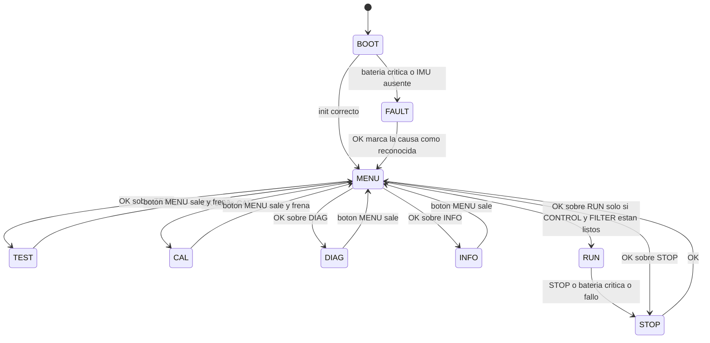
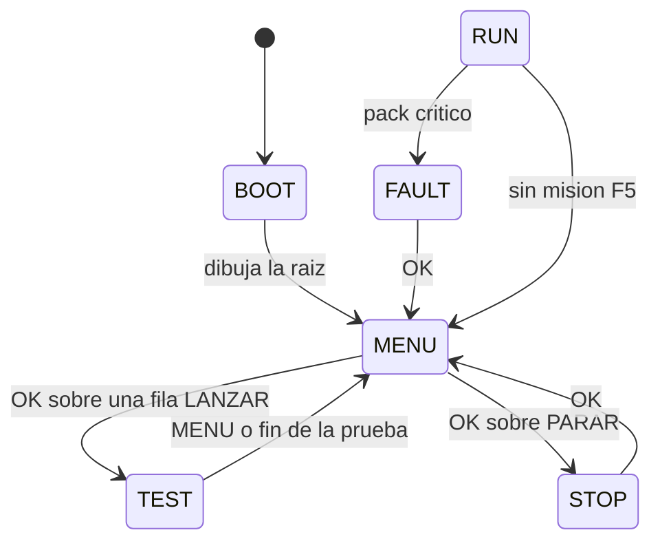
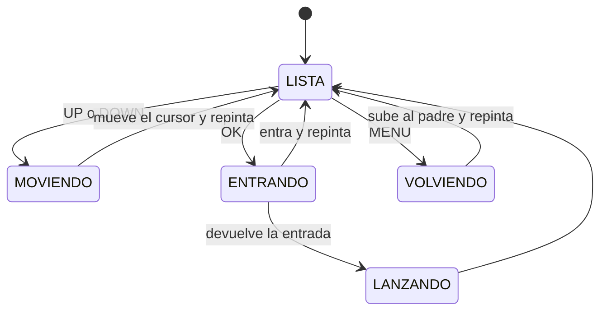

# 🎛️ Máquina de estados y menú en la capa APP — diseño

> **Estado:** ✅ **IMPLEMENTADO el 2026-09-28** (fases M0, M1 y M2). Este documento sigue siendo el
> contrato de diseño; lo que se hizo distinto se anota en la sección 0.
> Contexto: [estado-del-proyecto.md](./estado-del-proyecto.md) · [pruebas-bringup.md](./pruebas-bringup.md) ·
> [pruebas-pendientes.md](./pruebas-pendientes.md) · [../firmware/app/](../firmware/app/)

---

## 0. Qué se implementó (y en qué se desvió del diseño)

| Fase | Estado | Notas |
|:----:|:------:|:------|
| M0 · Glifos | ✅ | Añadidos `F G R X`, `+`, `/` y `>` a `app/oled.c`. El **2026-10-11** se completó el alfabeto con `H J Q Y Z` (25 B), que es lo que permite escribir `DERECHA`, `IZQUIERDA` y `AJUSTE` |
| M1 · Menú | ✅ | `app/menu.c/h` (nuevo) + máquina de estados en `application.c` |
| M2 · Banco lanzable | ✅ | ⚠️ **Sin `bench.c` ni `APP_Pump()`**: las pruebas siguen en `application.c` y su bucle es `while (!BUTTONS_SalidaSolicitada())` |
| M3 · CAL/DIAG | ✅ | Dentro de TEST (bloques) y en DIAG; los asistentes guiados son pruebas que salen con MENU |
| M4 · FAULT | ✅ | Batería crítica ⇒ frena y avisa. **Se sale con `OK`** aunque siga crítico (30-sep) |
| M5 · RUN | ❌ | Bloqueado hasta que existan CONTROL y FILTER |
| **M6 · FSM** | ✅ | **Menú y APP como máquinas de estados** con el patrón `fsm` (`app/fsm.h`) y árbol nuevo: TEST (4 bloques) · EXPLORE · RESOLVE · SETTINGS · DIAG · PARAR (30-sep) |
| **M7 · Árbol por bloques** | ✅ | **Segundo árbol** (11-oct): la raíz deja de ser `TEST`/`EXPLORE`/… y pasa a ser **bloques de trabajo** — `BATERIA` · `IR` · `MOTORES` · `TELEMETRIA` · `EXPLORACION` · `RESOLUCION` · `AJUSTES` · `DIAGNOSTICO` · `PARAR`. Además: **voltaje del pack en la cabecera de la raíz** (`MENU_SetVoltaje()`, refresco cada 2 s) y los glifos `H J Q Y Z`. Ver [esquema-firmware.md](./esquema-firmware.md) §6 |

**Tres cambios de diseño, los tres a mejor:**

1. **El botón MENU va por INTERRUPCIÓN** (EXTI línea 14, PC14) en vez de por sondeo. Es lo que
   permite que responda **siempre**, incluso dentro del `while (1)` de una prueba: la pulsación se
   cuenta aunque nadie llame a `BUTTONS_Update()`. Ver `hal/gpio.c` y `BUTTONS_SalidaSolicitada()`.
2. **No hace falta `APP_Pump()`**: con la interrupción, cada prueba solo comprueba la salida en la
   condición de su bucle. Menos cambios en las 17 rutinas.
3. **El FAULT es abandonable con `OK`** (30-sep): el robot queda frenado y el aviso sigue, pero se
   puede volver al menú. Con fuente de laboratorio o una batería que no sea 2S LiPo, la crítica es lo
   normal y no puede encerrar el robot. Los umbrales se mueven en caliente: `BAT CRIT_PACK 6000`
   ([comandos-serie.md](./comandos-serie.md)).

**Ficheros**: `app/menu.c/h` (nuevo), `app/console.c/h` (nuevo: órdenes que llegan por la UART),
`application.c/h` (FSM + tablas del menú), `buttons.c/h` (API de salida), `hal/gpio.c` + `hal/gpio.h`
(EXTI) y `src/main.c` (`EXTI15_10_IRQHandler`, `USART3_IRQHandler`).
Compilado el 2026-09-28 con el menú recién hecho: **RAM 8,7 % · Flash 50,4 %**. Con CONTROL, la
odometría, las 19 pruebas y la consola el binario va por el **69,7 %**
(ver `estado-del-proyecto.md`).

> [!NOTE] De aquí en adelante se reproduce el **diseño propuesto** antes de programar
> Los apartados siguientes son el plan que se escribió ese día. Donde digan `app/bench.c` o
> `APP_Pump()` hay que leer **`app/application.c`** y **`while (!BUTTONS_SalidaSolicitada())`**: son
> dos de las desviaciones del §0 (no se creó `bench.c` ni hizo falta el *pump*), y donde diga que el
> FAULT solo se sale si la causa desapareció, leer que **se sale siempre con `OK`** (la tercera).

---

## 1. Objetivo

Antes de este cambio, `app/application.c` era un **banco de pruebas**: se elegía *una* `App_Test_*()`
comentando una línea en `APP_Run()`, se compilaba, se flasheaba y se miraba la telemetría. Funcionaba,
pero obligaba a tener el PC y el ST-Link al lado para cada prueba.

Se quiere que el robot **se controle solo con los 4 botones y la pantalla**:

1. Una **máquina de estados** en la capa APP (`BOOT → MENU → {TEST, CAL, DIAG, INFO} → …`).
2. Un **menú** en la OLED navegable con `UP`/`DOWN`/`OK`/`MENU`.
3. Que el menú pueda **lanzar cualquier prueba de banco**, de modo que la telemetría siga
   disponible pero deje de ser obligatoria.
4. Que el camino hacia la misión (`RUN`) quede ya reservado, aunque hoy esté bloqueado.

### Invariantes que respeta

| Invariante | Cómo |
|---|---|
| **Arquitectura por capas** | `menu.c`, `application.c` y el banco están en **APP**; no se añade ni una llamada nueva a `HAL_*` desde fuera de HAL |
| **Un periférico por prueba** | Las pruebas 1–17 siguen existiendo igual; el menú solo las **invoca**, no las reescribe |
| **Observabilidad** | Toda transición emite telemetría (`>APP:estado`) además de pintar la pantalla |
| **Bring-up antes que sistema** | El estado `RUN` no se desbloquea hasta que existan CONTROL, FILTER y odometría |

⚠️ **Excepción declarada y temporal**: durante el bring-up, APP llama directamente a SENSOR y HAL
(lo hace ya hoy: `IMU_Init()`, `OLED_Init()`…). Es inevitable en un banco de pruebas; la regla
estricta APP→CONTROL→FILTER→SENSOR→HAL se cerrará cuando `CONTROL` exista y publique el estado que
el menú solo tenga que *leer*.

---

## 2. Máquina de estados



### Tabla de estados

| Estado | Qué hace | Salidas | Motores |
|---|---|---|---|
| `APP_STATE_BOOT` | `APP_InitAll()`, pantalla de arranque, primera medida de batería, comprobación de OLED/IMU | `MENU`, `FAULT` | frenados |
| `APP_STATE_MENU` | Navegación del árbol (no bloqueante). Es el **estado por defecto** | `TEST`, `CAL`, `DIAG`, `INFO`, `RUN`, `STOP`, `FAULT` | frenados |
| `APP_STATE_TEST` | Ejecuta **una** prueba de banco de `bench.c`, la que elija el menú | `MENU` al pulsar `MENU` o al terminar | según la prueba (cada una frena al salir) |
| `APP_STATE_CAL` | Asistentes guiados de calibración (PPR/µm, curva IR, k de los divisores, offset del giroscopio) | `MENU` | según el paso; los que mueven ruedas frenan al salir |
| `APP_STATE_DIAG` | Diagnósticos de bus (`I2C`, loopback SPI) y estado de periféricos | `MENU` | frenados |
| `APP_STATE_INFO` | Pantalla de información: versión, `VBAT`, estado de OLED/IMU, ticks | `MENU` | frenados |
| `APP_STATE_RUN` | Misión (wall follower / flood fill). **Hoy no existe**: muestra `NO DISP` | `STOP` | **en marcha** |
| `APP_STATE_STOP` | Parada controlada: frena, avisa por LED y espera | `MENU` con `OK` | frenados |
| `APP_STATE_FAULT` | Fallo: frena, LED a 4 Hz, muestra en la OLED la causa y `OK: VOLVER AL MENU` | `MENU` **con `OK` siempre** (ver nota) | frenados |

> [!NOTE] El FAULT se abandona con `OK`, aunque la causa siga ahí (decisión del usuario, 30-sep)
> El robot queda **frenado** y el aviso **sigue** (telemetría y LED), pero `OK` devuelve al menú: la
> batería crítica es una situación **normal** en el banco (fuente de laboratorio, batería de otra
> química, umbrales sin ajustar) y no puede dejar el robot encerrado sin poder hacer pruebas.
> Al salir se marca `fault_reconocido` y no se vuelve a entrar hasta que la medida **se recupere**
> (el estado deje de ser crítico) y vuelva a caer: así no hay bucle `FAULT → MENU → FAULT`.
> El umbral crítico se puede mover en caliente por consola: `BAT CRIT_PACK 6000`
> ([comandos-serie.md](./comandos-serie.md)).

> El `AppState_t` de `application.h` tiene hoy un único valor (`APP_STATE_IDLE`): se
> **sustituye** por esta enumeración, no se amplía en paralelo.

---

## 3. Bucle temporal

El corazón del diseño: **una sola función periódica** que alimenta todo lo que caduca por tiempo.

| Tarea | Frecuencia | Notas |
|---|---|---|
| `BUTTONS_Update()` | **1 kHz** | Obligatorio: el antirrebote son 30 muestras = 30 ms |
| `BATTERY_Update()` | 1 kHz | Acumula medias (2 conversiones ≈ 42 µs): cuanto más a menudo, más suave |
| `CONSOLE_Update()` | 1 kHz | Saca los bytes de la UART (los guarda su interrupción) y ejecuta las órdenes |
| Lectura de encoders | 1 kHz | Necesaria para la odometría y para el PID futuro |
| `MENU_Update()` (dibujo) | **~25 Hz** | La OLED no necesita más y así el bus I2C queda libre |
| Telemetría de estado | 10 Hz | `>APP:estado`, `>VBAT`, señales de la prueba activa |

```c
/* Boceto, NO implementado */
void APP_Run(void)
{
    while (1) {
        APP_Update();      /* 1 ms: botones + batería + encoders + máquina de estados */
        HAL_Delay(1);
    }
}
```

### ⚠️ El problema de las pruebas bloqueantes de hoy

Las `App_Test_*()` actuales son `while (1)` con `HAL_Delay()`. Dentro de ese bucle **nadie llama a
`BUTTONS_Update()`**, así que los botones no responden y no se puede salir de la prueba.

Solución propuesta, en dos fases:

**Fase A — barata, para ya.** Un ayudante que sustituye a `HAL_Delay()`:

```c
/* Boceto, NO implementado */
void APP_Pump(uint32_t ms)          /* alimenta botones y batería a 1 kHz */
{
    for (uint32_t i = 0; i < ms; i++) {
        BUTTONS_Update();
        BATTERY_Update();
        HAL_Delay(1);
    }
}
```

Y **una línea** al final de cada bucle de prueba:

```c
if (BUTTONS_WasPressed(BTN_MENU)) { DRV8833_Brake(&motor1); DRV8833_Brake(&motor2); return; }
```

Con esto: `HAL_Delay(n)` → `APP_Pump(n)`, y cualquier prueba se sale pulsando `MENU`.
Sin reescribir la lógica de las pruebas.

**Fase B — la buena, cuando toque CONTROL.** Cada prueba pasa a trío no bloqueante:

```c
void     X_Init(void);        /* preparar hardware y variables */
uint8_t  X_Step(uint32_t t);  /* da UN paso; 0 = sigue, 1 = terminada */
```

Es la misma interfaz que necesitará el lazo de control (velocidad, odometría), así que no es
trabajo perdido: es el ensayo del patrón.

---

## 4. Árbol del menú

```text
MENU ................................ cabecera: "MENU"
├── TEST ........................... lanzar una prueba de banco
│   ├── 1 ADC SOLDADURA ............ prueba 13
│   ├── 2 EMISORES IR .............. prueba 14
│   ├── 3 IR RECEPTORES ............ prueba 15
│   ├── 4 IR MODULADO .............. prueba 16
│   ├── 5 CALIBRACION IR ........... prueba 17
│   ├── 6 BATERIA .................. prueba 12
│   ├── 7 ENCODERS ................. prueba 4
│   ├── 8 MOTORES ENCODERS ......... prueba 2
│   ├── 9 RAMPA PWM ................ prueba 9
│   ├── 10 BOTONES OLED ............ prueba 10
│   ├── 11 I2C SCAN ................ prueba 11
│   ├── 12 IMU ..................... prueba 5
│   ├── 13 SPI LOOPBACK ............ prueba 6
│   └── 14 CALIB ENCODERS .......... prueba 7
├── CAL ........................... asistentes de calibración
│   ├── 1 PPR Y UM ................. prueba 7 modo 1 y 2
│   ├── 2 CURVA IR ................. prueba 17
│   ├── 3 K DIVISORES .............. prueba 12 + multímetro
│   └── 4 OFFSET GIRO .............. IMU quieta 3 s
├── DIAG .......................... diagnóstico de buses y periféricos
│   ├── 1 BUS I2C .................. prueba 11
│   ├── 2 SPI LOOPBACK ............. prueba 6
│   └── 3 ESTADO ................... VBAT + OLED + IMU + ticks
├── INFO .......................... versión y datos del robot
├── RUN ........................... misión (muestra NO DISP por ahora)
└── STOP .......................... parada
```

**Presentación en la OLED 128×32**: 4 líneas a escala 1 (8 px cada una).
La cabecera ocupa la primera; quedan **3 líneas de opciones**, así que las listas largas se
**desplazan** con `UP`/`DOWN`. El cursor se marca con `>` delante del ítem.

Cuando la lista **no cabe entera** (`n > MENU_FILAS_VISIBLES`), la cabecera añade el contador `i/n`
— `TEST MOTORES 8/11` —: las listas **dan la vuelta** por los extremos, así que sin él no hay forma
de saber que quedan opciones por debajo. Se nota sobre todo con lo que se añade al final de la lista
(`PID`, `ODOMETRIA`), que sin contador parece no existir.

### Mapa de botones

| Botón | En la raíz y en submenús | Dentro de una prueba o asistente |
|:------|:-------------------------|:---------------------------------|
| **UP** | subir en la lista | paso anterior / incrementar valor |
| **DOWN** | bajar en la lista | paso siguiente / decrementar valor |
| **OK** | entrar en el submenú (o lanzar la acción) | confirmar el paso (congelar una medida) |
| **MENU** | en un submenú: volver al padre · en la raíz: nada | **SALIR** de la prueba (frena y vuelve a `MENU`) |

Los eventos ya vienen numerados como potencias de dos desde `BUTTONS_GetEvent()`
(`1 MENU · 2 UP · 4 DOWN · 8 OK`), que es justo lo que necesita un menú: no hay que mezclar
pulsaciones y nunca se pierde una.

---

## 5. ⚠️ Restricción real: faltan glifos en la fuente

El driver de la OLED tiene una fuente **propia y mínima** (`oled_chars[]` / `oled_font[]` en
`app/oled.c`). Hoy solo hay glifos de:

> espacio · `0-9` · `A B C D E I K L M N O P S T U V W` · `-` · `:`

| Etiqueta que querríamos | ¿Se puede hoy? | Falta |
|---|:---:|---|
| `MENU`, `TEST`, `CAL`, `STOP`, `BAT`, `IMU`, `ADC`, `WALL`, `SPI2`, `SEL`, `OK`, `NO` | ✅ | — |
| `RUN`, `IR`, `DER`, `ERROR`, `MEDIR` | ❌ | **`R`** |
| `INFO`, `FILTRO` | ❌ | **`F`** |
| `DIAG` | ❌ | **`G`** |
| `MAX` | ❌ | **`X`** |

**Decisión tomada (2026-09-28): la opción (a), ya aplicada.** Se han añadido a `app/oled.c` los
7 glifos **`F` `G` `R` `X`**, `+`, `/` y `>` (el `>` es el cursor del menú), así que el menú habla
en español sin renombrar etiquetas.

- **(b) Descartada**: renombrar las etiquetas para no salirse de las letras que había (`TEST`,
  `CAL`, `MODO`…). Ahorraba código, pero forzaba nombres y justo `RUN`/`IR` son los que se usan.

---

## 6. Ficheros y capas

| Fichero | Capa | Responsabilidad | Estado |
|:--------|:----:|:----------------|:------:|
| `app/application.c/h` | APP | `APP_InitAll()`, `APP_Update()`, máquina de estados | ♻️ **reescribir**: deja de ser el banco |
| `app/menu.c/h` | APP | Árbol de menú, navegación, dibujo en la OLED | 🆕 **nuevo** |
| `app/bench.c/h` | APP | Las 17 rutinas `App_Test_*` **movidas** aquí, invocables desde el menú | 🆕 nuevo (mover) |
| `app/oled.c/h` | APP | Añadir los glifos de §5 | ✏️ ampliar |
| `app/buttons.c/h` | APP | Ya sirve tal cual (`GetEvent`, `WasPressed`, 1 kHz) | ✅ sin cambios |
| `app/battery` → `sensor/battery.c/h` | SENSOR | Ya sirve (`BATTERY_GetEstado()`, avisos) | ✅ sin cambios |
| `extra_script.py` | build | Ya compila **todo** `app/*.c` (`BuildSources`) ⇒ **no hay que tocarlo** | ✅ sin cambios |

### Interfaces propuestas (bocetos, no implementación)

```c
/* app/application.h */
typedef enum {
    APP_STATE_BOOT = 0,
    APP_STATE_MENU,
    APP_STATE_TEST,
    APP_STATE_CAL,
    APP_STATE_DIAG,
    APP_STATE_INFO,
    APP_STATE_RUN,
    APP_STATE_STOP,
    APP_STATE_FAULT
} AppState_t;

void        APP_InitAll(void);
void        APP_Update(void);          /* 1 ms: botones + sensores + FSM */
void        APP_Run(void);             /* while (1) { APP_Update(); HAL_Delay(1); } */
void        APP_Pump(uint32_t ms);     /* 1 kHz durante ms, para las pruebas */
AppState_t  APP_GetState(void);
const char *APP_GetStateName(void);    /* "MENU", "TEST", … para telemetría y OLED */
void        APP_FrenoTotal(void);      /* frena los dos motores: usado en cada salida */

/* app/menu.h */
typedef enum {
    MENU_ITEM_TEST = 0, MENU_ITEM_CAL, MENU_ITEM_DIAG,
    MENU_ITEM_INFO, MENU_ITEM_RUN, MENU_ITEM_STOP, MENU_ITEM_COUNT
} Menu_Item_t;

void        MENU_Init(void);
void        MENU_Update(void);              /* navegación + dibujo; NO bloquea */
Menu_Item_t MENU_GetSeleccion(void);
uint8_t     MENU_GetSubIndice(void);        /* ítem dentro de la lista activa */
uint8_t     MENU_ConsumirEntrada(void);     /* 1 al pulsar OK sobre algo elegible */

/* app/bench.h */
typedef struct {
    const char *nombre;      /* etiqueta de la OLED */
    void      (*run)(void);  /* la prueba; vuelve al pulsar MENU */
    uint8_t     numero;      /* nº de prueba de pruebas-bringup.md */
} Bench_Test_t;

const Bench_Test_t *BENCH_Tabla(void);
uint8_t             BENCH_Total(void);
```

**Por qué una tabla `const` de pruebas**: añadir una prueba nueva pasa a ser **una fila** en
`bench.c` en vez de un `case` nuevo en la máquina de estados. El menú (TEST, CAL, DIAG) es solo
un índice sobre la misma tabla, con tres filtros distintos.

---

## 7. Seguridad y reglas de oro

| Regla | Motivo |
|---|---|
| **Ninguna transición deja los motores girando** | `APP_FrenoTotal()` en la entrada/salida de `TEST`, `CAL` y `RUN` |
| **`BATTERY_GetEstado() == CRITICA` ⇒ `FAULT`** | Protege la LiPo de 450 mAh (no arrancar la misión con la batería baja). **Solo en `RUN`** y **se sale con `OK`** aunque siga crítico |
| **Toda transición se anuncia** | `>APP:estado` por telemetría: se puede reconstruir la sesión sin mirar la pantalla |
| **El menú nunca bloquea** | Si el bus I2C se cuelga, el robot sigue alimentando botones y batería |
| **Un `MENU` siempre sale** | Salida de emergencia única desde cualquier prueba |
| **Sin NVM por ahora** | No se guarda nada en flash: un reset vuelve a `BOOT`. Cuando exista la calibración, decidir (opciones: `#define` compilados o guardar en la flash del F103) |

⚠️ **Interacción con el freno de banco**: `src/main.c` tiene hoy `//while(1){;}` antes de
`APP_Run()`. Con la máquina de estados ese freno se quita igual que ahora cuando se quiera usar el
robot; **no se introduce ningún «modo freno» nuevo** (decisión del usuario del 2026-09-20).

---

## 8. Plan de implementación por fases

> Cada fase se documenta en [estado-del-proyecto.md](./estado-del-proyecto.md) al cerrarse.

| Fase | Alcance | Puerta de salida |
|:----:|:--------|:-----------------|
| **M0** | Decidir los glifos (§5) y añadirlos a `oled.c` | `INFO` y `RUN` se ven enteros en la pantalla |
| **M1** | `APP_Update()` + estados `BOOT/MENU/STOP` + `menu.c` navegable (sin acciones) | Recorrer el árbol entero con los 4 botones, la raíz siempre alcanzable |
| **M2** | Mover las pruebas a `bench.c` + `APP_Pump()` + salida con `MENU` | Lanzar cualquier prueba desde la pantalla y **salir de ella** sin el PC |
| **M3** | Estados `CAL` y `DIAG` con los asistentes de las pruebas 7/12/17 | Calibrar PPR, µm y k de los divisores solo con botones |
| **M4** | `FAULT` con la batería y arranque bloqueado si no hay IMU | Batería crítica ⇒ el robot frena y lo dice en la pantalla |
| **M5** | `RUN` con la misión | **Bloqueado** hasta que existan CONTROL + FILTER + odometría |

Prerrequisito de M2: **acabar de soldar** el ADC (divisores de batería y los 4 canales IR) y pasar
las pruebas 13–17, que son las que el menú va a ofrecer en primer lugar.

---

## 9. Qué **no** se hace en este documento

- ❌ No se define el contrato de CONTROL/FILTER: eso es otro documento, cuando toque.

---

## 10. Máquinas de estados implementadas (2026-09-30)

Todo lo de arriba sigue valiendo, pero desde el 30-sep las máquinas se escriben con el patrón de
`app/fsm.h` (Remo Dentato, *Finite States Machines in C*): **cada estado es un bloque con etiqueta y
cada transición un `goto` explícito**. Ventajas: el código se lee como el diagrama, el depurador
salta de etiqueta en etiqueta (breakpoint por estado) y no hay `switch` con `break` olvidados.

Reglas del patrón (están en el propio header): un `fsm { }` por función, exactamente un `START`, nada
de código entre estados, y variables declaradas dentro de su estado.

> [!IMPORTANT] Nuestra adaptación: `START` es un **despachador**
> Estas máquinas **se reanudan de llamada en llamada** (cada 1 ms), no corren de una tirada como los
tokenizadores del artículo. Por eso `START` mira en qué estado se quedó la máquina y salta a él, y ahí
van también las **guardas globales** (batería crítica), que pueden interrumpir cualquier estado.

### FSM de la APP (`application.c`)



> [!IMPORTANT] La batería crítica **solo** corta la misión, no el banco (30-sep)
> El `FAULT` por batería se alcanza **únicamente desde `RUN`** (misión). En el menú y en las pruebas se
> trabaja con **fuente de laboratorio** y una batería baja no puede tapar la pantalla, parpadear el LED
> ni cortar una prueba — lo que pasaba era eso: cada vez que la medida caía por debajo del umbral, el
> robot saltaba al `FAULT` y parecía que las acciones del menú «no hacían nada». Para ver la batería
> están la **prueba 12** y la telemetría (`>VBAT_ESTADO`, `>VBAT`).

| `>APP_EST` | Estado | Qué hace |
|:----------:|:-------|:---------|
| 0 | `BOOT` | `MENU_Init()` y a navegar |
| 1 | `MENU` | `MENU_Update()`: un paso de la FSM del menú |
| 2 | `TEST` | Llama a la rutina elegida (**bloqueante**, sale con MENU), frena y repinta. Antes pinta un **cartel con el nombre de la prueba** (casi ninguna escribe en la pantalla) |
| 3 | `STOP` | Frena hasta que se pulse OK |
| 4 | `FAULT` | Aviso de batería + pantalla con `OK: VOLVER AL MENU`. **Solo se llega desde `RUN`** |
| 5 | `RUN` | Placeholder de misión (F5) |

### FSM del MENÚ (`menu.c`)



| `>MENU_EST` | Estado | Qué hace |
|:-----------:|:-------|:---------|
| 0 | `LISTA` | Con botón navega; sin botón **no hace nada** (ni publica ni repinta) |
| 1 | `MOVIENDO` | `menu_mover_cursor(±1)` + `MENU_Dibujar()` |
| 2 | `ENTRANDO` | Submenú → entra y repinta · acción → la deja en `MENU_Update()` |
| 3 | `VOLVIENDO` | `menu_volver_padre()` + repinta **solo si de verdad subió** |

Además, al repintar se publican `>MENU_PROF` (nivel) y `>MENU_IDX` (fila), y al lanzar una prueba
`>APP_TEST:1` + `>APP_TEST_N:<fila>`. Con eso se reconstruye la navegación entera desde Teleplot.

### Árbol (implementado)

```
RABOSA-MVR                        (6 filas, con scroll)
├── TEST          ─┬─ ANALOGICO  ADC · ADC SOLDADURA · BATERIA
│                   ├─ IR         EMISORES IR · IR RECEPTORES · VER R0 · VER R1 · VER R2 · VER R3 · IR MODULADO · CURVA IR
│                   ├─ MOTORES    MOVIMIENTO · ENCODERS · PPR A MANO · UM MOTORES · MOTORES ENCOD · MIN M1 · MIN M2 · MIN AMBOS · COMPARA M · RAMPA PWM · PID · ODOMETRIA
│                   └─ VARIOS     IMU · BOTONES OLED · I2C SCAN · SPI LOOPBACK
├── EXPLORE       ─┬─ MANO DER
│                   └─ FLOOD FILL
├── RESOLVE        └─ RESOLVER
├── SETTINGS      ─┬─ BATERIA · VELOCIDAD · PID · LABERINTO · TELEMETRIA · GUARDAR · RESET
├── DIAG          ─┬─ BUS I2C · SPI LOOPBACK · BATERIA
└── PARAR          (acción inmediata)
```

> Los bloques de TEST existen porque 17 pruebas en una lista de 3 filas visibles se navegan fatal.
> **Añadir una prueba = una fila en su bloque**; **añadir un submenú = una tabla y una fila en
> `submenus[]`** (el índice es el contrato).

### Dos bugs que salieron al estrenar el menú en hardware (30-sep)

1. **El antirrebote se medía en llamadas** (30 muestras suponiendo 1 kHz). Como el bucle bajaba a
   ~20 Hz, hacían falta **1,5 s** de pulsación: el botón nunca se registraba. Ahora se mide **tiempo
   real** con `HAL_GetTick()` (30 ms).
2. **El menú se redibujaba cada 40 ms** y cada `OLED_Update()` son ~50 ms de bus I2C, así que el
   bucle se auto-limitaba a ~20 Hz (y eso es lo que hacía fallar el punto 1). Ahora **solo se redibuja
   al navegar**.

---

## 11. Qué **no** se hace todavía

- ❌ Las pantallas de `SETTINGS` (fase M6b: editor de valores con UP/DOWN/OK).
- ❌ Persistir ajustes en la flash del F103 (`GUARDAR`/`RESET`).
- ❌ Mover las pruebas de `application.c` a una FSM no bloqueante (decisión del 30-sep: se quedan
  bloqueantes y el MENU por interrupción sigue siendo la salida de emergencia).

> Siguiente paso concreto: **decidir §5 (glifos)**, montar el ADC y ejecutar la **prueba 13**.
